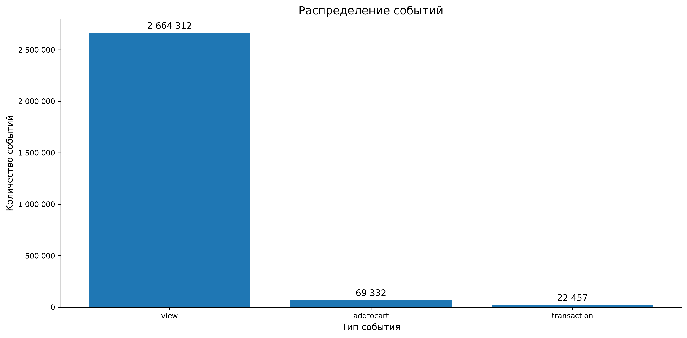
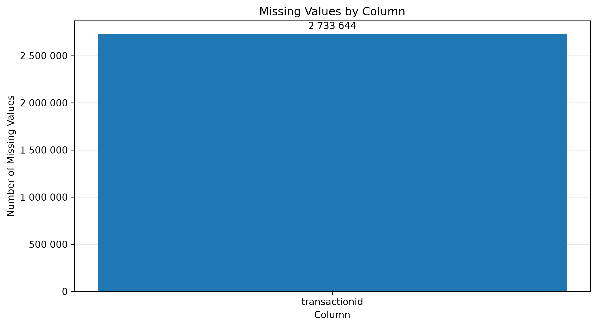
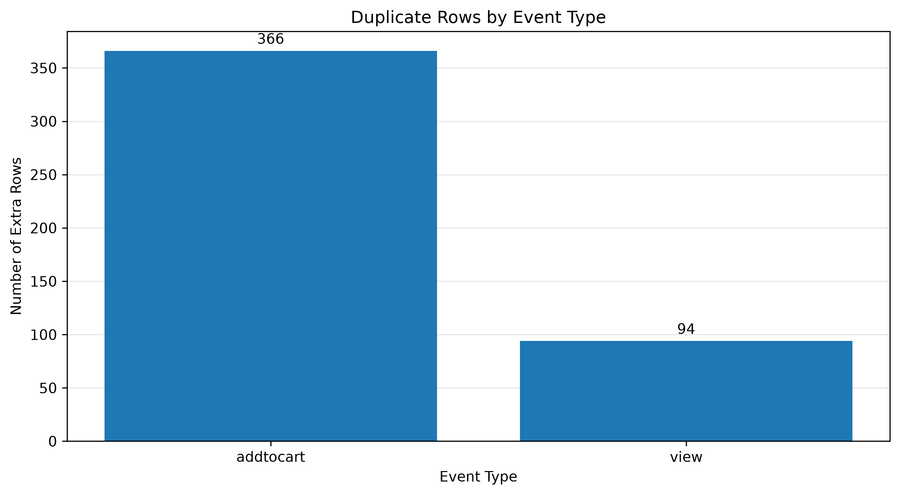

# Data Quality Report

## 1. О проекте

`events.csv` — события интернет-магазина за период с 3 мая по 18 сентября 2015 (UTC). В файле 2 756 101 строка и 5 столбцов: `timestamp`, `visitorid`, `event`, `itemid`, `transactionid`. Внутри три типа событий — просмотры, добавления в корзину и покупки. Всего 1 407 580 уникальных пользователей и 235 061 уникальный товар.

Порядок проверки: пропуски → дубликаты → целостность транзакций → временные метки. Ниже — что нашлось.

## 2. Что в файле

| Показатель | Значение |
|---|---:|
| Строк | 2 756 101 |
| Столбцов | 5 |
| Уникальных пользователей | 1 407 580 |
| Уникальных товаров | 235 061 |
| Уникальных транзакций | 17 672 |

События распределены так:

| Тип | Количество |
|---|---:|
| `view` | 2 664 312 |
| `addtocart` | 69 332 |
| `transaction` | 22 457 |

Просмотров 96,7% от всех событий — они задают «нормальный» режим активности. Покупок меньше 1%, поэтому в большинстве отчётов покупка будет редким событием, и на графиках её придётся либо увеличивать, либо смотреть отдельно.

## 3. Пропуски

Пропуски есть только в `transactionid`: 2 733 644 пустых значения. В остальных четырёх столбцах (`timestamp`, `visitorid`, `event`, `itemid`) пропусков нет вообще.

Заполнять или удалять эти пропуски не требуется: пустой `transactionid` у `view` и `addtocart` — не дефект, а прямое следствие того, что событие не связано с покупкой.

## 4. Дубликаты

Полных дублей — 460 лишних строк. По типам:

| Тип | Лишних строк |
|---|---:|
| `addtocart` | 366 |
| `view` | 94 |
| `transaction` | 0 |

Отдельно проверена связка `transactionid` + `itemid` — найдено ещё 134 лишние строки. Но у них разные `timestamp`, то есть это не «один и тот же факт дважды», а скорее повторное событие в другое время. Без `event_id` отличить технический дубль от реального повтора нельзя, поэтому автоматическая чистка была бы неоправданной.

Пока дубликаты оставлены как есть. К ним имеет смысл вернуться позже — сравнить метрики на данных с дублями и без, чтобы понять, влияют ли они на выводы в принципе.

## 5. Транзакции

В `transaction` 22 457 строк, но уникальных `transactionid` — только 17 672. То есть в среднем одна транзакция содержит около 1,27 строки, а в максимуме — до 31 товара. Каждая транзакция привязана ровно к одному `visitorid`, пересечений между пользователями нет.

Из этого сразу следует практический вывод: если считать «заказы» как строки `transaction`, получится завышение примерно на 27%. Поэтому везде, где речь идёт про заказы, используется `transactionid`, а не количество строк.

## 6. Временные метки

Метки в порядке: пропущенных нет, нулевых нет, отрицательных нет. Конвертация из Unix milliseconds в UTC datetime прошла без ошибок. Минимум — 3 мая 2015, 03:00:04 UTC; максимум — 18 сентября 2015, 02:59:47 UTC.

Одна деталь, которую стоит держать в голове при чтении остальных отчётов: и первый, и последний календарные дни неполные — данные начинаются и заканчиваются не в 00:00. При расчёте дневной активности эти два дня либо исключаются, либо помечаются отдельно, чтобы не сравнивать их с полными.

## 7. Чего в данных нет

Короткий список того, что будет ограничивать все следующие ноутбуки:

- **Нет `session_id`.** Сессии восстанавливаются по 30-минутному таймауту — это эвристика, а не исходная разметка.
- **Нет цен и выручки.** Ни AOV, ни GMV, ни LTV посчитать нельзя.
- **Нет `quantity`.** По одной строке `transaction` нельзя сказать, сколько физических единиц купили.
- **Нет `event_id`.** Значит, полные дубликаты нельзя однозначно пометить как технические.
- **Нет информации о часовом поясе и методике сбора.** Всё время — UTC, но где сидят пользователи, неизвестно.
- **Разная длительность наблюдения.** Кто-то впервые появился в мае, кто-то — в сентябре. «Среднее по пользователю» смешивает людей с очень разным временем в датасете.

## 8. Итог

Файл рабочий: 2,76 млн событий, пропуски смысловые, временные метки корректные. Главные ограничения — отсутствие денег, сессий и `event_id`. Поэтому анализ в следующих ноутбуках строится на событиях и их последовательности, а не на выручке.

Исходные записи не изменялись — для анализа делается отдельная копия с полями `datetime`, `date`, `hour`. В нескольких местах по тексту остались ссылки на конкретные числа: `460` полных дублей, `134` повторов по `transactionid + itemid`, `1,27` строки на транзакцию. Если понадобится сравнить с более поздними версиями выгрузки, эти три значения стоит держать в голове — они чувствительны к тому, как именно считать дубли.
