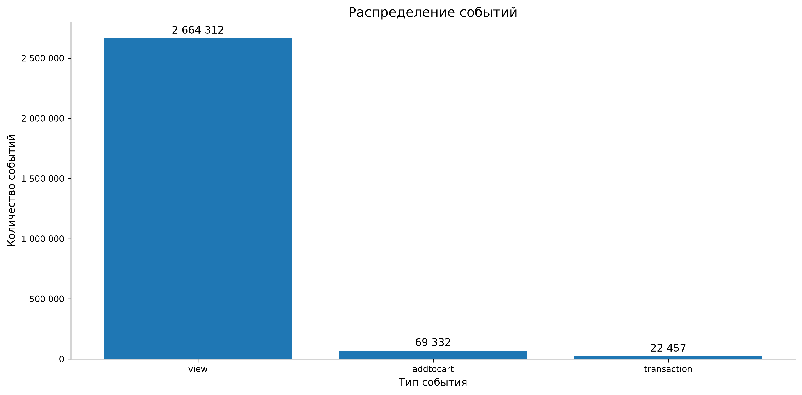
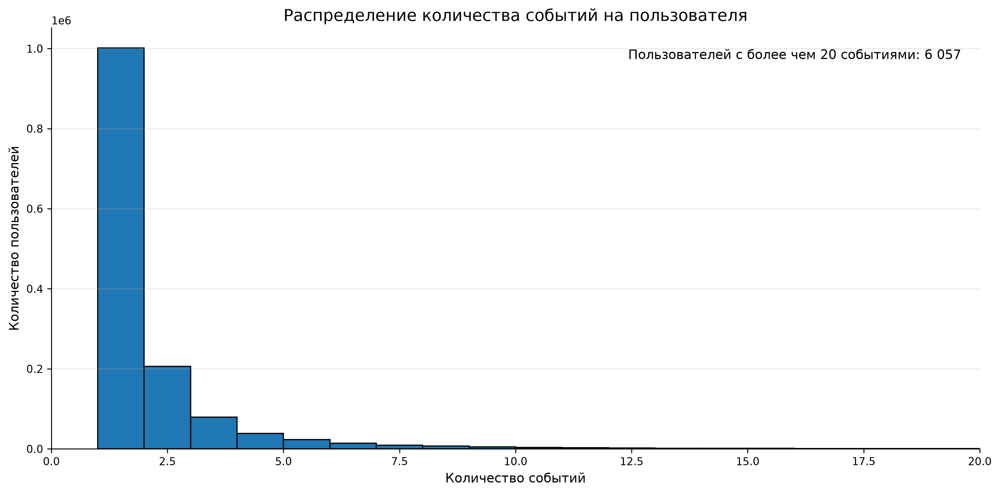
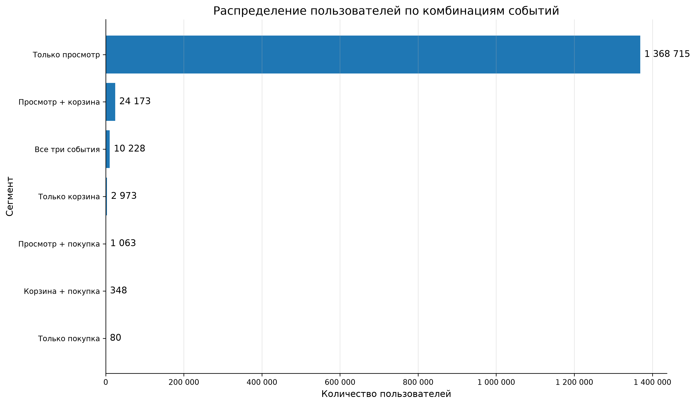
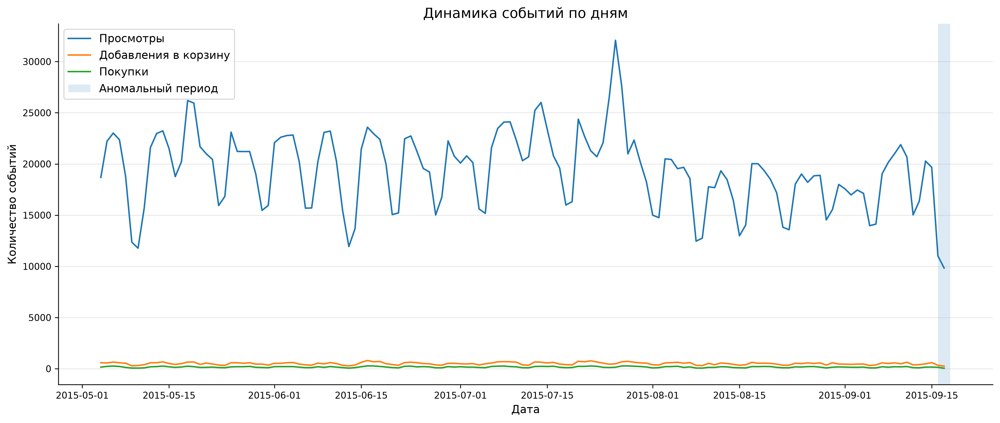
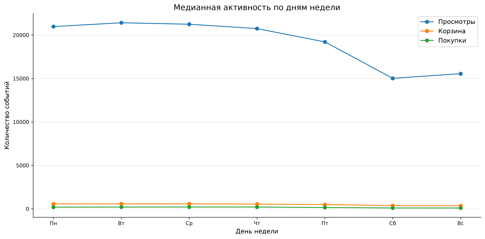
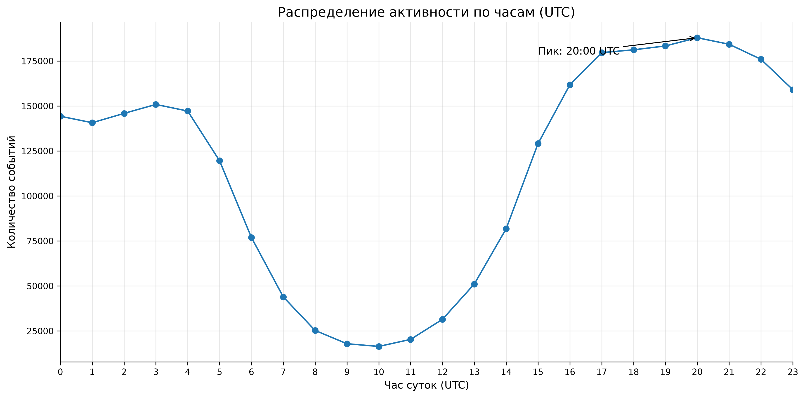
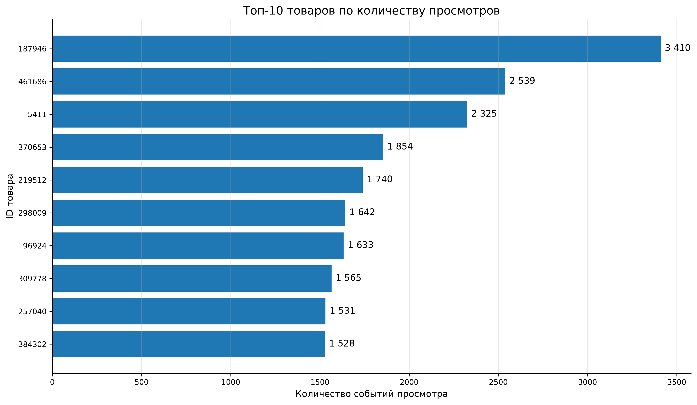
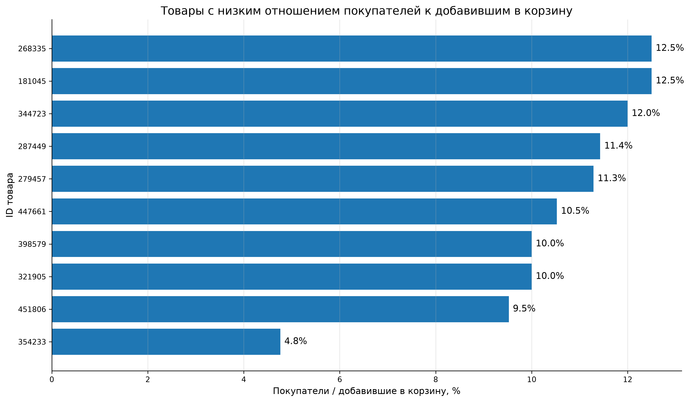

# EDA

## 1. Цель

Цель — пройтись по данным на первом уровне: понять, как ведут себя пользователи, что происходит во времени, какие товары выделяются на общем фоне и что из этого стоит проверить дальше.

Данные — `events.csv`, три типа событий: `view`, `addtocart`, `transaction`.

## 2. Данные

Источник — `events.csv`. Для анализа создана копия `events_clean` с полями `datetime` (UTC), `date` и `hour`. Исходник не изменялся.

Дубликаты в EDA специально не удалялись — в отчёте по качеству данных (01) уже разобрано, почему без `event_id` их нельзя однозначно отделить от настоящих повторов.

Что внутри:

- 2 756 101 строка;
- 1 407 580 уникальных пользователей;
- 235 061 уникальный товар;
- 17 672 транзакции;
- период 3 мая — 18 сентября 2015.

По типам событий:

| Тип | Количество |
|---|---:|
| `view` | 2 664 312 |
| `addtocart` | 69 332 |
| `transaction` | 22 457 |

Просмотры — 96,7% от всех событий. Это важно учитывать при чтении всех графиков дальше: всё, что связано с корзиной и покупками, на общем фоне будет выглядеть «тонким», и масштабировать такие срезы придётся отдельно.

Отдельно: строки `transaction` — не заказы. Одна транзакция может содержать несколько товаров, так что если считать «заказы» по строкам, получится завышение. Везде дальше, где речь про заказы, используется `transactionid`.

## 3. Распределение активности

Медиана — 1 событие на пользователя. Среднее — 1,96. По квантилям:

| Квантиль | Событий |
|---|---:|
| 50% | 1 |
| 75% | 2 |
| 90% | 3 |
| 95% | 5 |
| 99% | 13 |
| 99,9% | 47 |

У половины пользователей — ровно одно действие, после чего активность прекращается. У 90% — не больше трёх. А в хвосте есть пользователи с 47+ событиями, и они дают заметную долю общего объёма.

Из-за этого среднее 1,96 плохо описывает «типичного» пользователя — оно перекошено вправо. Поэтому в следующих отчётах чаще используются медиана и перцентили, а не mean.

## 4. Пересечения событий

По всей истории: у 99,76% пользователей есть хотя бы один `view`, у 2,68% — `addtocart`, у 0,83% — `transaction`. Если разложить по всем комбинациям сразу:

| Сегмент | Пользователей |
|---|---:|
| Только просмотр | 1 368 715 |
| Просмотр + корзина, без покупки | 24 173 |
| Все три события | 10 228 |
| Только корзина | 2 973 |
| Просмотр + покупка, без корзины | 1 063 |
| Корзина + покупка, без просмотра | 348 |
| Покупка без просмотра и корзины | 80 |

Главное: 1 368 715 человек (97,2%) вообще не вышли за пределы просмотров. Ещё 24 173 дошли до корзины, но не купили. Три нижние строки таблицы — те, у кого в данных есть покупка, но нет предшествующих этапов. Скорее всего, это неполная история событий, а не реальное поведение, но проверить без логов трекинга не получится.

По этой таблице самое интересное для дальнейшего разбора — не «только просмотр» (их слишком много и они однородные), а 24 173 «просмотр + корзина без покупки». Эти уже сделали шаг в сторону покупки, но остановились — именно у них вероятнее всего найти конкретную проблему.

Оговорка: это сегменты по всей истории, а не по одной сессии. Один и тот же пользователь в разные дни может попадать в разные комбинации, здесь же берётся итог за весь период.

## 5. Время

### 5.1. По дням

139 календарных дней. В среднем — 19 828 событий, 11 867 пользователей и 12 030 товаров в день.

Первый и последний дни неполные: 3 мая данные начинаются около 03:00 UTC, 18 сентября заканчиваются около 03:00 UTC. При сравнении дневной активности эти два дня либо исключаются, либо помечаются отдельно.

### 5.2. Провал 16–17 сентября

Два дня выбиваются из общей картины:

| Дата | `view` | `addtocart` | `transaction` |
|---|---:|---:|---:|
| 16 сентября | 11 022 | 336 | 137 |
| 17 сентября | 9 830 | 253 | 45 |

В сравнении с медианой того же дня недели:

| Дата | Метрика | Отклонение |
|---|---|---:|
| 16 сентября (среда) | просмотры | −48,13% |
| 16 сентября (среда) | корзина | −41,72% |
| 16 сентября (среда) | покупки | −33,66% |
| 17 сентября (четверг) | просмотры | −52,61% |
| 17 сентября (четверг) | корзина | −53,41% |
| 17 сентября (четверг) | покупки | −78,16% |

Просели все три типа событий одновременно, и не в выходной, а в середине недели. На недельную сезонность это не похоже. Причины могут быть разные — сбой выгрузки, реальное падение активности, проблема в трекинге. По самому файлу отличить одно от другого нельзя, служебных полей для этого нет. Так что 16–17 сентября помечаются как аномальный период, и при интерпретации дневных графиков это учитывается.

### 5.3. По дням недели

Медианы по дням недели:

| День | `view` | `addtocart` | `transaction` |
|---|---:|---:|---:|
| Пн | 20 976,5 | 570,5 | 195 |
| Вт | 21 416,5 | 579 | 198,5 |
| Ср | 21 250 | 576,5 | 206,5 |
| Чт | 20 743,5 | 543 | 206 |
| Пт | 19 217 | 493 | 153 |
| Сб | 15 024 | 370 | 98 |
| Вс | 15 557 | 356 | 97 |

Вторник и среда — самые активные. В выходные заметно ниже, особенно по покупкам: 98 в субботу против 206,5 в среду — разница примерно в два раза. Это описательная картина; проверка значимости — в отчёте 08, там χ² по дню недели даёт крошечный p-value, но Cramér's V ≈ 0,013, то есть на практике различие слабое. Здесь это просто наблюдение, а не вывод о сезонности.

### 5.4. По часам

Пик суммарной активности — около 20:00 UTC, минимум — в 9:00–11:00 UTC.

Важная оговорка: всё в UTC, и не известно, где сидят пользователи. Если большая часть аудитории — условно Европа, то 20:00 UTC — это 22:00 по местному, что для пика странно. Если США — наоборот. Без данных о часовом поясе часовой график читается только как «активность по UTC», без привязки к реальному распорядку дня пользователей.

## 6. Товары

Для каждого товара рассчитаны три отношения по уникальным пользователям: покупатели / просмотревшие, добавившие в корзину / просмотревшие, покупатели / добавившие в корзину. Это не конверсии в строгом смысле — порядок событий не учитывается, — но как грубый индикатор «проблемных» товаров работает.

### 6.1. Лидеры по активности

`187946` — абсолютный лидер по просмотрам: 3 410 событий, 2 911 уникальных пользователей, при этом 2 добавления в корзину и ноль покупок. Хороший пример того, что много просмотров ≠ интерес к покупке.

`461686` — противоположный случай: 2 539 просмотров, 306 добавлений в корзину, 133 события покупки, 129 уникальных покупателей. По корзинам и покупкам это первый товар в выборке.

Разница между этими двумя товарами — самое наглядное, что даёт этот раздел: высокий трафик на карточку и высокая конверсия в покупку — не одно и то же.

### 6.2. Высокое отношение покупателей к просмотревшим

Среди товаров с минимум 100 уникальными просмотревшими:

| Товар | Просмотревшие | Покупатели | Отношение |
|---|---:|---:|---:|
| `213834` | 199 | 80 | 40,20% |
| `334401` | 130 | 24 | 18,46% |
| `416017` | 186 | 32 | 17,20% |
| `119736` | 251 | 42 | 16,73% |

`213834` резко выделяется: 40% просмотревших его купили. Но с выводами спешить не стоит — 199 просмотревших это мало, и один-два «горячих» дня могли дать такой результат. Проверять надо на временной динамике, а её в этом срезе нет.

### 6.3. Низкое отношение покупателей к добавившим в корзину

Фильтр тот же, плюс ≥20 добавивших в корзину:

| Товар | Просмотревшие | Добавившие в корзину | Покупатели | Отношение |
|---|---:|---:|---:|---:|
| `354233` | 847 | 21 | 1 | 4,76% |
| `451806` | 238 | 21 | 2 | 9,52% |
| `398579` | 216 | 20 | 2 | 10,00% |
| `321905` | 356 | 20 | 2 | 10,00% |
| `447661` | 451 | 38 | 4 | 10,53% |
| `279457` | 358 | 62 | 7 | 11,29% |
| `287449` | 160 | 35 | 4 | 11,43% |

`354233` — самый явный кандидат: 847 просмотревших, 21 добавивший в корзину и всего 1 покупка. Что могло пойти не так — цена, доставка, наличие, что-то на checkout. По этим данным не установить, но на разбор user journey товар просится.

По всем товарным отношениям: они посчитаны по всей истории и не учитывают временной порядок. То есть «покупатель» и «просмотревший» — это независимые счётчики, а не последовательность. Если покупка была раньше повторного просмотра, пользователь попадёт в оба счётчика.

## 7. Гипотезы для дальнейших шагов

Из EDA вышли такие кандидаты на проверку:

| Наблюдение | Гипотеза | Где проверять |
|---|---|---|
| 97,2% — только просмотры | Пользователи не находят причин идти дальше | Воронка (03) |
| 24 173 — просмотр + корзина без покупки | Что-то мешает на checkout | User journey (06) |
| `187946` — много просмотров, ноль покупок | Карточка не убеждает купить | Разбор карточки |
| `461686` — активность на всех этапах | Реальный спрос на товар | Аудитория и динамика |
| `354233` — 1 покупка на 21 корзину | Проблема после добавления в корзину | User journey + условия |
| 16–17 сентября — резкий провал | Сбой сбора / выгрузки | Сверить с источником данных |

Это гипотезы, а не выводы. Часть из них уже разобрана в следующих отчётах, часть остаётся на будущее.

## 8. Ограничения

Главное, что влияет на интерпретацию:

1. **Нет `session_id`** — сессии в следующих отчётах восстанавливаются по 30-минутному таймауту, это эвристика, а не исходная разметка.
2. **Нет цен и выручки** — GMV, AOV, LTV не считаются, все метрики только в событиях и пользователях.
3. **Нет `event_id`** — полные дубликаты нельзя однозначно отделить от реальных повторов.
4. **Строки `transaction` ≠ заказы** — одна транзакция может содержать несколько товаров.
5. **Неизвестны часовой пояс и методика сбора** — все временные выводы привязаны к UTC, а не к локальному времени пользователей.
6. **Разная длительность наблюдения** — кто-то появился в мае, кто-то в сентябре.
7. **Первый и последний дни неполные**, плюс аномалия 16–17 сентября.

## 9. Итог

Коротко, что даёт EDA для дальнейшей работы:

- Активность крайне неоднородна: медиана 1 событие, 90-й перцентиль — 3, но есть пользователи с десятками и сотнями событий.
- 97,2% пользователей не выходят за пределы просмотров. Основная воронка теряет людей на переходе view → addtocart.
- Внутри этой массы есть отдельная интересная группа — 24 173 человека с корзиной, но без покупки. Именно её логично разбирать в 03 (воронка) и 06 (user segmentation).
- Высокие просмотры ≠ высокие продажи: `187946` (2 911 просмотревших, 0 покупок) и `461686` (1 379 просмотревших, 129 покупателей) — крайние примеры.
- 16–17 сентября — аномалия, которую нельзя списать на недельную сезонность. При интерпретации дневных графиков эти два дня надо либо исключать, либо помечать.
- Всё, что связано с деньгами, здесь посчитать нельзя — нужных полей в датасете просто нет.
