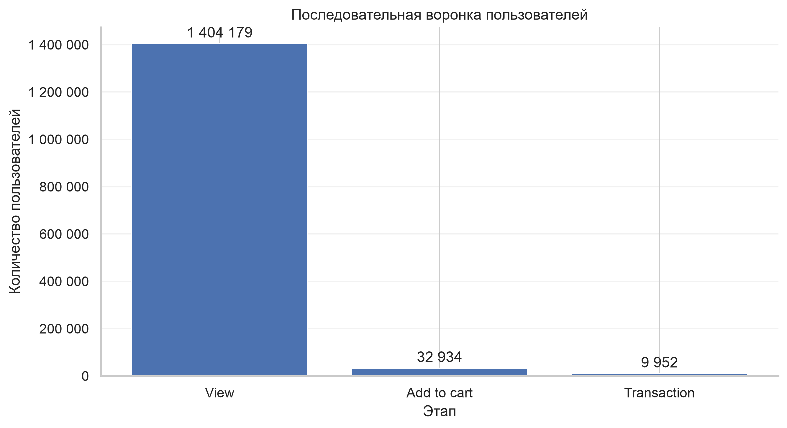
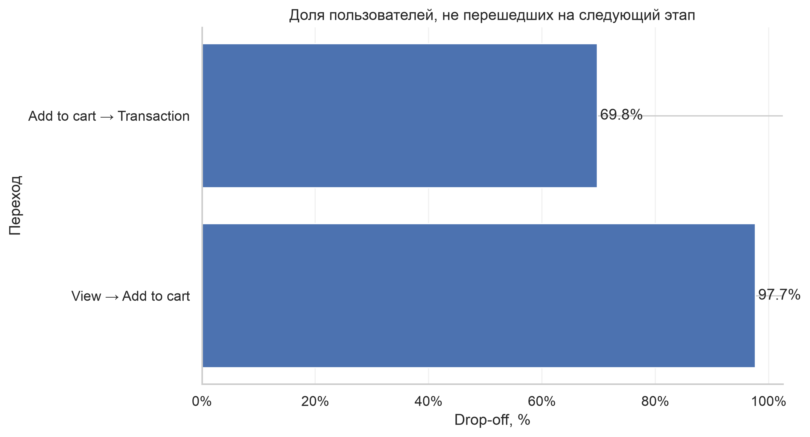
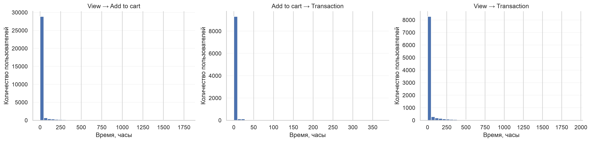

# Conversion Funnel Analysis Report

## 1. Цель

Задача — пройти по воронке **View → Add to cart → Transaction** на уровне пользователей и понять, где именно теряется аудитория. Плюс отдельно посмотреть воронку на уровне пары «пользователь — товар», где все три этапа относятся к одному и тому же товару, и сверить результаты.

## 2. Данные и метод

Источник — `events.csv`, период 03.05.2015 — 18.09.2015 (UTC). В анализ входят три события: `view`, `addtocart`, `transaction`.

После фильтрации записей с пропусками в нужных полях — 2 756 101 событие и 1 407 580 уникальных пользователей.

Логика построения воронки: для каждого `visitorid` берётся самое раннее время каждого типа события, и пользователь попадает на следующий этап, только если порядок соблюдён — `view` не позже `addtocart`, а `addtocart` не позже `transaction`. Это строгое правило по первым событиям: если у пользователя самое раннее `addtocart` случилось раньше первого `view`, он не попадёт в этап, даже если позже проходил нормальную последовательность.

Отдельная оговорка по смыслу: пользовательская воронка объединяет события разных товаров. Просмотр может быть одного товара, добавление в корзину — другого, покупка — третьего. Это не ошибка, а сознательный выбор единицы анализа. Параллельно ниже строится воронка на уровне `visitorid + itemid`, где все этапы относятся к одному товару — она ближе к «товарной» логике.

## 3. Пользовательская воронка

| Этап | Пользователей |
|---|---:|
| View | 1 404 179 |
| Add to cart | 32 934 |
| Transaction | 9 952 |

### 3.1. Конверсии

| Переход | Конверсия |
|---|---:|
| View → Add to cart | 2,35% |
| Add to cart → Transaction | 30,22% |
| View → Transaction | 0,71% |

### 3.2. Потери

| Переход | Потеря пользователей | Drop-off |
|---|---:|---:|
| View → Add to cart | 1 371 245 | 97,65% |
| Add to cart → Transaction | 22 982 | 69,78% |

Основной барьер — переход от просмотра к корзине. Из 1 404 179 пользователей с просмотром до добавления в корзину доходят 32 934, то есть 2,35%. На следующем переходе ситуация обратная: из тех, кто дошёл до корзины, 30,22% покупают. То есть «проблема» концентрируется на первом шаге, а не на втором.

Одна цифра, которая обычно остаётся за кадром в таких отчётах: всего в датасете 37 722 пользователя с `addtocart` и 11 719 — с `transaction`. В воронку из них попали 32 934 и 9 952 соответственно. То есть примерно 4 800 пользователей с корзиной и 1 767 покупателей в воронку не попали — у них нарушен порядок первых событий. Это не ошибка данных, а следствие выбранного правила (см. §6). Стоит помнить: воронка описывает не «всех, кто дошёл до этапа», а «всех, кто дошёл в правильной последовательности».

## 4. Время между этапами

Для пользователей, дошедших до нужных этапов, посчитаны интервалы:

| Переход | Среднее | Медиана | P90 |
|---|---:|---:|---:|
| View → Add to cart | 75,31 ч | 3,66 мин | 94,74 ч |
| Add to cart → Transaction | 13,83 ч | 5,82 мин | 1,76 ч |
| View → Transaction | 101,52 ч | 23,52 мин | 219,73 ч |

Для верхних перцентилей:

- P95 для View → Add to cart — 475,61 ч;
- P95 для Add to cart → Transaction — 20,37 ч;
- P95 для View → Transaction — 675,01 ч.

Средние в разы больше медиан. Это классическая картина для временных интервалов: типичный пользователь доходит от просмотра до корзины за 3–4 минуты, а среднее раздувается за счёт тех, у кого между событиями прошли дни и недели. Поэтому в интерпретации дальше опираюсь на медиану и перцентили, а не на среднее — оно в этом распределении мало что описывает.

Отдельно про P95 = 475 часов: это почти 20 дней. То есть у 5% пользователей между просмотром и добавлением в корзину проходит больше трёх недель. Часть таких случаев наверняка объясняется тем, что воронка не ограничена по времени — пользователь мог вернуться к товару через месяц и добавить его в корзину, и это засчитывается.

## 5. Воронка на уровне пары «пользователь — товар»

Тот же анализ, но на уровне пар `visitorid + itemid`:

| Этап | Пар |
|---|---:|
| View | 2 132 127 |
| Add to cart | 45 810 |
| Transaction | 16 700 |

| Переход | Конверсия |
|---|---:|
| View → Add to cart | 2,15% |
| Add to cart → Transaction | 36,45% |
| View → Transaction | 0,78% |

Конверсия View → Add to cart на уровне пары немного ниже, чем на уровне пользователя (2,15% vs 2,35%). Это логично: пользователь может просмотреть много товаров, а добавить в корзину только один. Поэтому в пользовательской воронке шаг View → Cart «щедрее» — он засчитывает пользователя, если хотя бы один из его просмотров дошёл до корзины.

Конверсия Cart → Transaction на уровне пары, наоборот, выше: 36,45% против 30,22%. Здесь работает та же логика с другой стороны — добавление в корзину конкретного товара чаще ведёт к покупке именно этого товара, чем добавление «чего-то» ведёт к покупке «чего-то».

Две воронки не взаимозаменяемы. Первая отвечает на вопрос «сколько пользователей дошли до этапа», вторая — «сколько взаимодействий с конкретным товаром дошли до этапа». Для продуктовых решений важны обе, но путать их нельзя.

## 6. Диагностика последовательности

Проверены пользователи, у которых первые события не соответствуют ожидаемому порядку:

| Ситуация | Пользователей |
|---|---:|
| `addtocart` без более раннего `view` | 5 450 |
| `transaction` без более раннего `addtocart` | 1 272 |

Такие случаи могут объясняться неполной историей событий, взаимодействием вне отслеживаемого сценария или особенностями сбора данных. Автоматически считать их ошибкой оснований нет.

Важно понимать, что именно эти пользователи частично объясняют расхождение в §3: пользователь мог добавить товар в корзину до того, как впервые просмотрел что-либо. По правилу воронки такой пользователь выпадает из этапа `addtocart`, хотя фактически действие совершил.

## 7. Ограничения

- **Правило первых событий.** Если у пользователя раннее `addtocart` предшествует раннему `view`, он не попадёт в воронку, даже если позже действовал по «правильной» последовательности. Это консервативное правило; при более мягких условиях количества на этапах вырастут.
- **Нет ограничения по времени.** Между этапами могут проходить дни и недели — это видно по P95 в §4. Для «настоящей» сессионной воронки потребовалось бы окно, но в данных нет `session_id`.
- **Одинаковые timestamp.** Если у двух событий совпадает время, порядок однозначно установить нельзя. В расчётах используется нестрогое неравенство `>=`, то есть событие с тем же временем засчитывается как «после». На больших числах это влияет минимально, но для отдельных пользователей может менять результат.
- **Transaction ≠ заказы.** Показатель Transaction — количество пользователей, дошедших до покупки, а не количество заказов или транзакций. Одна транзакция может содержать несколько товаров.
- **Конверсия — не причина.** Все цифры показывают наблюдаемую связь между этапами. Почему пользователи не переходят с одного этапа на другой — по этим данным не установить.

## 8. Итог

Коротко, что даёт воронка:

- Главный барьер — переход от просмотра к корзине. Дошли только 2,35% пользователей (32 934 из 1 404 179). Дальше воронка «держит» гораздо лучше: до покупки доходят 30,22% из тех, кто был в корзине.
- Пользовательская и товарная воронки дают разные цифры (2,35% / 30,22% / 0,71% против 2,15% / 36,45% / 0,78%). Это не противоречие, а разные единицы анализа.
- Медианное время View → Cart — около 3,7 минуты, Cart → Transaction — около 5,8 минуты. Средние в десятки раз больше из-за длинного правого хвоста.
- Не все покупатели проходят воронку последовательно: 1 767 пользователей с `transaction` в неё не попали. Так же и с корзиной — около 4 800 пользователей не попали в этап `addtocart`. Это прямое следствие правила «первых событий» и частично — неполной истории.
- 5 450 пользователей добавили товар в корзину без более раннего просмотра, 1 272 — совершили транзакцию без более раннего добавления. Часть из них, скорее всего, просто имеет неполную историю в данных.