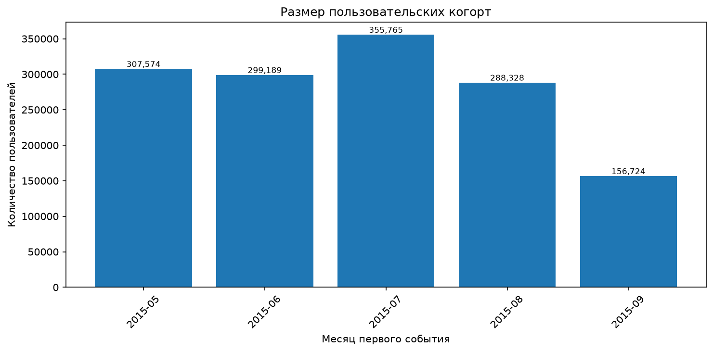
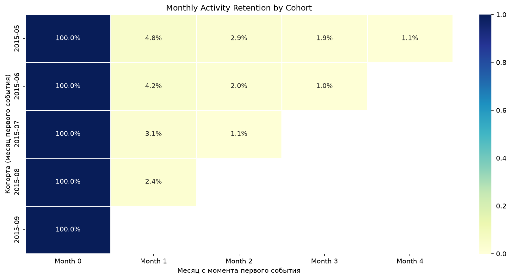

# Cohort Analysis Report

## 1. Цель

Задача — разложить пользователей по месяцу первого события и посмотреть, как они возвращаются в следующие месяцы. Основные вопросы: сколько людей в каждой когорте, какая доля возвращается через месяц, через два и так далее, и меняется ли эта доля от когорты к когорте.

## 2. Данные и метод

Источник — `events.csv`, период 03.05.2015 — 18.09.2015 (UTC). После подготовки данных — 2 756 101 событие и 1 407 580 уникальных пользователей.

Когорта определяется по месяцу первого зафиксированного события пользователя в датасете. Это важная оговорка: не по дате регистрации (её в данных нет), а по первому появлению в логах. Если пользователь реально пришёл в апреле, но первое событие попало в майскую выгрузку, он попадёт в майскую когорту.

Активность в месяце — это наличие хотя бы одного события любого типа. То есть пользователь считается «вернувшимся» в месяц N, если в этом месяце у него есть хотя бы один `view`, `addtocart` или `transaction`. Покупка не обязательна. Это Activity Retention, а не Purchase Retention.

Month 0 — месяц первого события, Month 1 — следующий календарный месяц, и так далее.

## 3. Размеры когорт

| Когорта | Пользователей |
|---|---:|
| Май 2015 | 307 574 |
| Июнь 2015 | 299 189 |
| Июль 2015 | 355 765 |
| Август 2015 | 288 328 |
| Сентябрь 2015 | 156 724 |
| **Всего** | **1 407 580** |

Июльская когорта — самая крупная (355 765). Сентябрьская — самая маленькая (156 724), но сравнивать её с остальными напрямую нельзя: сентябрь в данных неполный, наблюдение обрывается 18-го числа. То есть у сентябрьской когорты Month 0 — это не полный месяц, а примерно половина.

## 4. Матрица удержания

| Когорта | Month 0 | Month 1 | Month 2 | Month 3 | Month 4 |
|---|---:|---:|---:|---:|---:|
| Май 2015 | 100% | 4,76% | 2,86% | 1,89% | 1,05% |
| Июнь 2015 | 100% | 4,23% | 2,02% | 0,96% | — |
| Июль 2015 | 100% | 3,08% | 1,09% | — | — |
| Август 2015 | 100% | 2,43% | — | — | — |
| Сентябрь 2015 | 100% | — | — | — | — |

Month 0 везде 100% — по определению, в него входят все пользователи когорты. Прочерки в правой части матрицы — не нули, а отсутствие данных: у августовской когорты в датасете есть только сентябрь, у сентябрьской — вообще ничего после Month 0.

Общая картина: удержание падает очень быстро. Даже в самой «хорошей» майской когорте до Month 1 доживает меньше 5% пользователей. К Month 4 остаётся около 1%. Это согласуется с EDA: медиана событий на пользователя — 1, то есть половина аудитории вообще не возвращается после первого действия.

## 5. Что происходит с майской когортой

Майская когорта — единственная, для которой в данных есть полные четыре месяца после первого. По ней видно, как затухает активность:

| Период | Retention | Пользователей |
|---|---:|---:|
| Month 0 | 100% | 307 574 |
| Month 1 | 4,76% | 14 643 |
| Month 2 | 2,86% | 8 796 |
| Month 3 | 1,89% | 5 809 |
| Month 4 | 1,05% | 3 238 |

Из 307 574 человек через месяц вернулись 14 643, а к четвёртому месяцу активность сохранили только 3 238. Падение от 4,76% до 1,05% — почти в пять раз между Month 1 и Month 4. Кривая затухания очень крутая, но при этом сама форма не «выпуклая» — нет плато, на котором удержание стабилизируется.

Практический смысл: для этой аудитории «месяц» — слишком длинная единица. Если 95% пользователей отваливаются уже после первого месяца, надо смотреть на дни или недели, а не на месяцы. Собственно, недельный разбор — в отчёте 05.

## 6. Сравнение когорт

Если смотреть только на Month 1 (единственный горизонт, доступный для всех полных когорт), видно последовательное снижение:

- Май — 4,76%;
- Июнь — 4,23%;
- Июль — 3,08%;
- Август — 2,43%.

Выглядит как ухудшение от когорты к когорте. Но здесь есть ловушка, о которой стоит сказать прямо: **сравнение не совсем честное**.

Майская когорта в Month 1 — это июнь, полный месяц. Июньская в Month 1 — это июль, тоже полный. А августовская когорта в Month 1 — это сентябрь, который в данных обрывается на 18-м числе. То есть у августовской когорты на возврат было не 30 дней, а примерно 18. Ожидаемо, что это занижает её Month 1.

Если у августовской когорты Month 1 = 2,43% при ~18 днях наблюдения, то экстраполяция на полный месяц дала бы заметно более высокое значение. Возможно, реального падения от когорты к когорте почти нет, а то, что видно в таблице — это частично эффект неполного сентября.

Проверить это можно, если считать Retention не по календарным месяцам, а по фиксированному окну (например, 30 дней от первого события для каждого пользователя). В этом ноутбуке такого расчёта нет, так что гипотезу про артефакт сентября здесь подтвердить или опровергнуть нельзя — только отметить.

Отдельная оговорка: причины возможного снижения в любом случае не установить по этим данным. Изменения в составе трафика, источниках привлечения, сезонность, реклама — всё это могло бы объяснить динамику, но в датасете этих полей нет.

## 7. Ограничения

- **Когорта = первое событие, а не регистрация.** Если у части пользователей история обрезана с начала периода, они попадут в майскую когорту, хотя реально пришли раньше. Это занижает реальный Retention майской когорты относительно более поздних.
- **Activity Retention, а не Purchase.** Пользователь считается активным, даже если в месяце у него был один `view`. Это даёт более высокие цифры, чем retention по покупкам. По этим данным такой показатель тоже можно было бы посчитать, но здесь его нет.
- **Сентябрь неполный.** У августовской и сентябрьской когорт Month 1 и Month 0 соответственно покрыты не полностью. Прямое сравнение их с полными месяцами даёт смещение (см. §6).
- **Разные горизонты.** Майская когорта наблюдается 5 месяцев, августовская — 2, сентябрьская — 1. Сравнивать когорты можно только на общем горизонте, то есть по Month 1.
- **Не объясняет причины.** Кривая затухания показывает «что», но не «почему». Провал от 4,76% до 1,05% может быть связан и с реальным уходом пользователей, и с тем, что им просто нечего было делать в магазине через 3 месяца. По этим данным различить причины нельзя.

## 8. Итог

Коротко:

- Удержание очень низкое на всех когортах: максимум 4,76% в Month 1, около 1% в Month 4. Это прямое следствие того, что половина пользователей совершает ровно одно действие.
- Майская когорта — единственная с полной историей, и её кривая затухания — самая показательная: 307 574 → 14 643 → 8 796 → 5 809 → 3 238.
- Формальное снижение Month 1 от 4,76% (май) до 2,43% (август) может быть частично артефактом: у августовской когорты Month 1 попадает на неполный сентябрь.
- Месяц как единица для этой аудитории слишком грубый. Если 95% отваливаются за первый месяц, надо смотреть недели — что и делается в отчёте 05.
- Когорта определяется по первому событию в данных, а не по регистрации. Для пользователей с «обрезанной» историей это может искажать относительные сравнения.

Дальше логично переходить к недельному удержанию (05), где видны более короткие интервалы возврата, и к сегментации (06), где можно проверить, отличается ли retention у покупателей и бросивших корзину.
