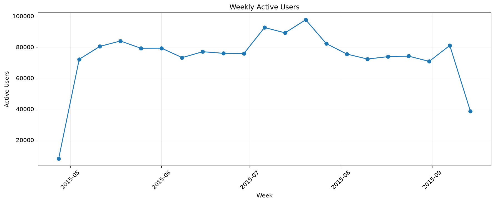
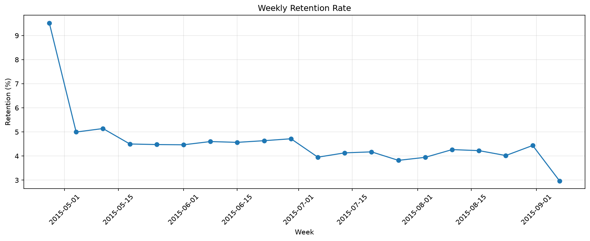
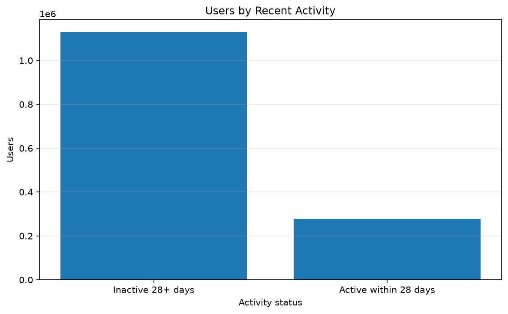
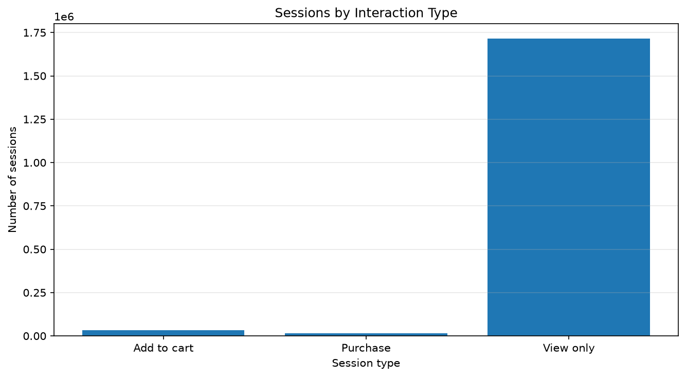

# Retention, Churn & Session Analytics Report

## 1. Цель

Задача — посмотреть на возвращаемость пользователей с двух сторон: в недельном разрезе (WAU, Weekly Retention) и через длительную неактивность. Плюс отдельно разобрать сессии — сколько их, какой длины и что в них происходит.

## 2. Динамика активности

Недельная активность держится в основном в диапазоне 70–97 тысяч уникальных пользователей. Пик — неделя 20 июля 2015: 97 609 активных пользователей и 175 437 событий.

Выраженного тренда на спад за весь период нет — активность колеблется, но не уползает. При этом первая и последняя календарные недели неполные: данные начинаются 3 мая и заканчиваются 18 сентября, поэтому эти две недели короче остальных. При сравнении недель их либо исключают, либо помечают отдельно.

Отдельно: неделя с пиком 20 июля — это ровно та же неделя, где заканчивается когорта июля в отчёте 04. Совпадение по датам не случайное, но связаны ли эти два наблюдения (пик WAU и максимальный размер июльской когорты), по имеющимся данным не установить — для этого нужен разбор источников трафика, а их в датасете нет.

## 3. Weekly Retention

Weekly Retention — доля пользователей, активных на текущей неделе и вернувшихся на следующей. В большинстве полных недель показатель 4–5%.

На неделе, начинающейся 7 сентября, значение 2,97%. Но здесь есть ловушка: следующая неделя (с 14 сентября) в данных обрывается 18-м числом, то есть покрыта примерно наполовину. Поэтому 2,97% — это не финальный результат, а заниженная оценка. Насколько заниженная — по этим данным не посчитать.

Ещё одна важная оговорка: это не когортный retention из отчёта 04. Там считались пользователи, вернувшиеся в тот же календарный месяц после первого события. Здесь — переход между соседними календарными неделями, без привязки к первому появлению. Это два разных показателя, и путать их нельзя, хотя они и называются одинаково.

В целом 4–5% недельного возврата — это низко, и это согласуется с EDA: медиана событий на пользователя равна 1, то есть половина аудитории уходит сразу после первого действия.

## 4. Длительная неактивность

Порог 28 дней: считаются пользователи, у которых не было ни одного события в последние 28 дней наблюдения (то есть с ~21 августа по 18 сентября).

- 1 129 581 пользователь (80,25%) — без событий за этот период;
- 277 999 пользователей (19,75%) — с активностью в пределах 28 дней.

80,25% — большая цифра, но называть её «churn» не совсем корректно. Отсутствие событий в течение 28 дней не доказывает, что пользователь окончательно ушёл: он мог уйти в отпуск, а мог вернуться через 2 месяца. Проверить это по датасету нельзя — наблюдение заканчивается 18 сентября, а история после этой даты отсутствует.

Кроме того, 28 дней — это аналитическое допущение, а не подтверждённое определение churn. Если взять 14 или 60 дней, цифры будут другими. Здесь выбор 28 дней — компромисс: достаточно длинный, чтобы отсечь обычные перерывы, но короткий, чтобы не потерять половину наблюдения.

## 5. Сессии

Сессии определены по 30-минутному таймауту: если между последовательными событиями одного пользователя прошло больше 30 минут, начинается новая сессия. Это эвристика — в данных нет `session_id`, поэтому граница проводится по времени.

Результаты:

- всего сессий — 1 761 675;
- уникальных пользователей — 1 407 580;
- среднее число событий на сессию — 1,56;
- медиана числа событий — 1;
- средняя продолжительность — 1,75 минуты;
- медианная продолжительность — 0 минут;
- однособытийных сессий — 1 378 895.

Медианная продолжительность равна нулю не из-за ошибки, а по определению: если в сессии одно событие, момент её начала совпадает с моментом окончания. А таких сессий 78,3% (1 378 895 из 1 761 675).

Из-за этого средняя продолжительность 1,75 минуты сама по себе мало информативна: она смешивает огромное число нулевых сессий с небольшим числом длинных. Для осмысленной оценки времени взаимодействия надо смотреть отдельно сессии с 2+ событиями — в этом ноутбуке такого расчёта нет, но это логичный следующий шаг.

## 6. Типы сессий

Сессии классифицированы по самому «продвинутому» событию:

| Тип | Сессий |
|---|---:|
| View only | 1 715 386 |
| Add to cart | 31 992 |
| Purchase | 14 297 |

Доли: 97,37% — только просмотры, 1,82% — с добавлением в корзину, 0,81% — с покупкой.

Категории взаимоисключающие: если в сессии была и корзина, и покупка, она попадает в «Purchase». Поэтому сессий с покупкой (14 297) меньше, чем пользователей с транзакцией (11 719) — тут сравнение в разных единицах, путать не надо.

Важная оговорка: это не воронка. Воронка в отчёте 03 строилась по пользователям и последовательности первых событий, а здесь — по сессиям и их составу. То, что 97,37% сессий — только просмотры, не означает, что 97,37% пользователей не доходят до корзины. Один пользователь за день мог сделать 5 сессий, из которых 4 — с просмотрами и 1 — с покупкой.

## 7. Ограничения

- **28 дней и 30 минут — эвристики.** Churn-порог и граница сессии выбраны вручную, при других значениях метрики будут другими. Это стоит держать в голове при сравнении с индустриальными бенчмарками — они обычно считаются по другой методике.
- **Первая и последняя недели неполные.** Данные начинаются 3 мая и заканчиваются 18 сентября, поэтому крайние недели короче остальных. Неделя с 14 сентября, на которой заканчивается наблюдение, короче в 2 раза.
- **Активность ≠ регистрация.** Нет даты регистрации, поэтому «вернувшимся» считается пользователь, у которого было событие на следующей неделе — независимо от того, когда он пришёл в продукт впервые.
- **Однособытийные сессии дают нулевую длительность.** Средняя продолжительность 1,75 мин смешивает нули и длинные сессии, что делает её малоинформативной.
- **Сессия ≠ пользователь.** Один пользователь за период может дать десятки сессий. Поэтому доли типов сессий и доли пользователей по типам поведения — это разные метрики (см. §6).
- **Транзакция в сессии ≠ все покупки пользователя.** Если пользователь совершил покупку в двух разных сессиях, в данных это будут две сессии с транзакцией, а не одна.

## 8. Итог

Коротко:

- Недельная активность колеблется в 70–97 тысяч, без явного тренда на спад. Пик — неделя 20 июля (97 609 WAU).
- Weekly Retention в полных неделях 4–5% — низко, но согласуется с тем, что половина пользователей совершает ровно одно действие (см. EDA, §3).
- 80,25% пользователей не имели событий в последние 28 дней. Но это не churn в строгом смысле — за пределами наблюдения (после 18 сентября) история отсутствует.
- 78,3% сессий — однособытийные. Средняя продолжительность 1,75 мин обманчива, потому что смешивает нули и длинные сессии.
- 97,37% сессий — только просмотры. Это не то же самое, что «97% пользователей уходят без покупки» — сессия и пользователь это разные единицы.
