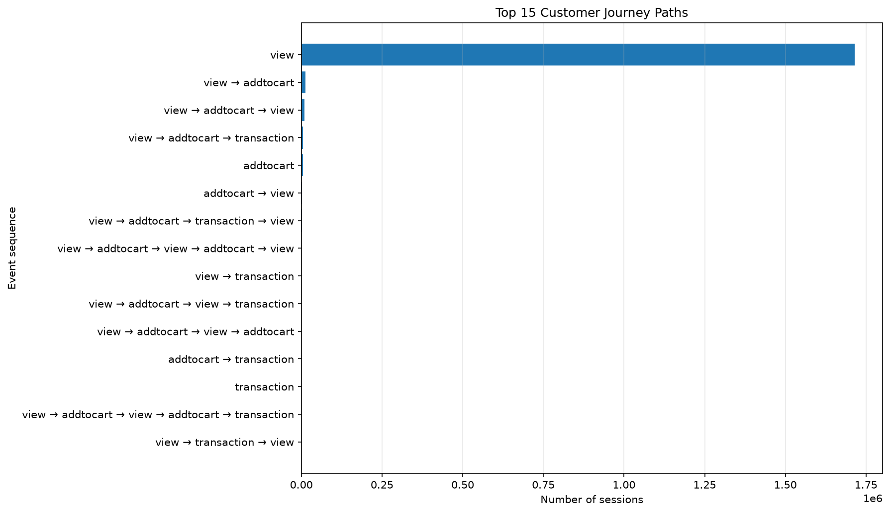
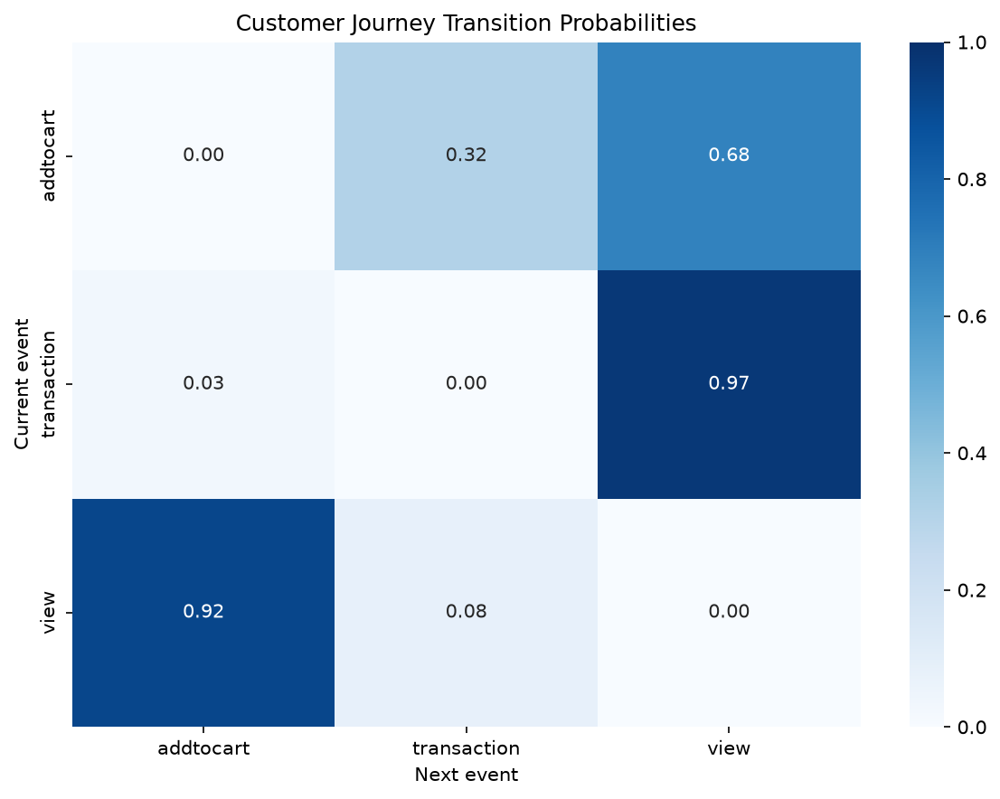
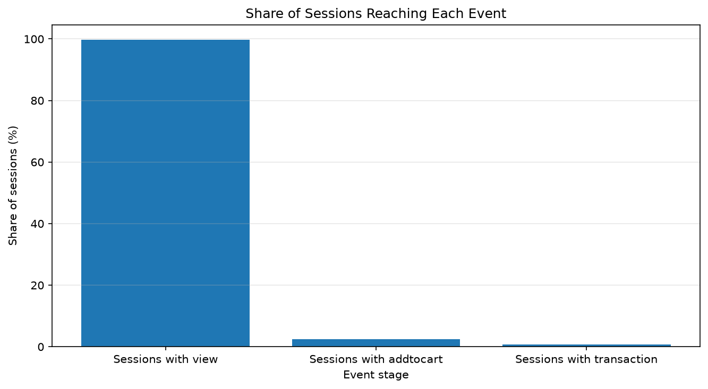
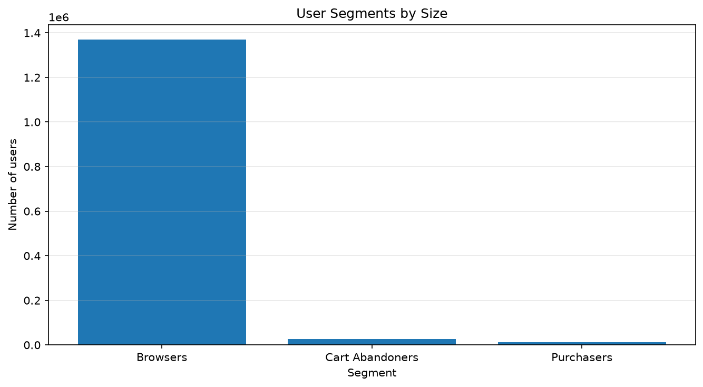
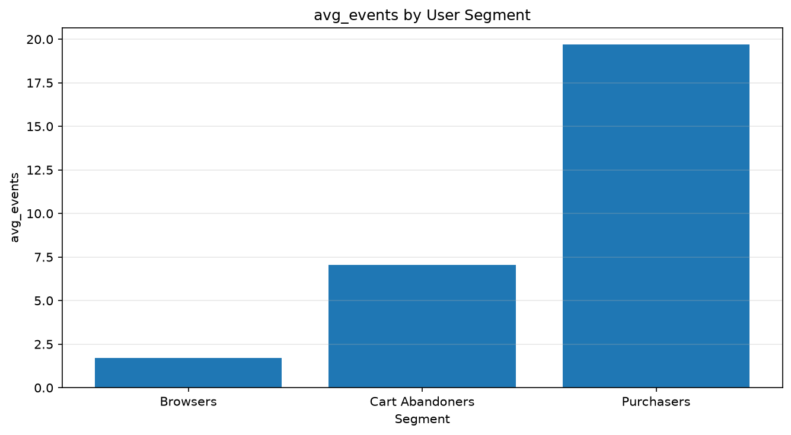
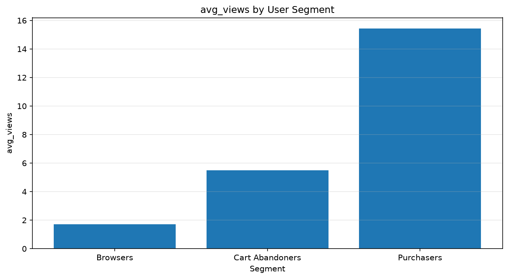
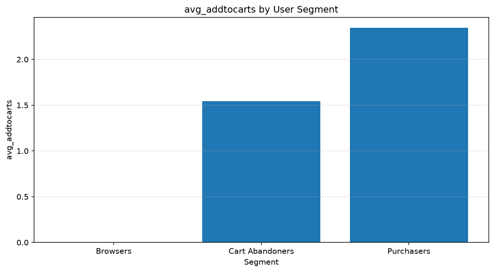
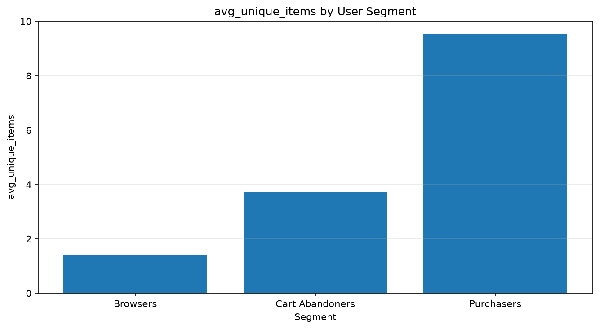
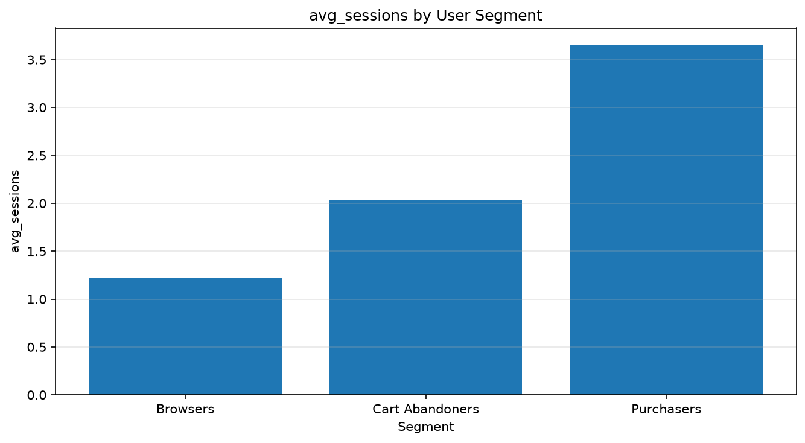
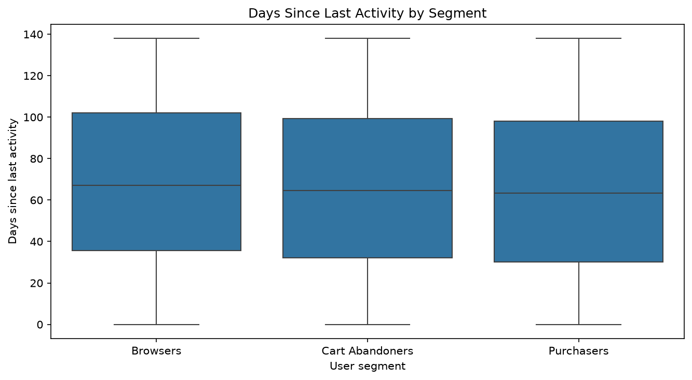

# Customer Journey & User Segmentation Report

## 1. Общая информация

**Проект:** E-commerce Product Analytics
**Ноутбук:** 06 — Customer Journey & User Segmentation
**Датасет:** `events.csv`
**Событий:** 2 756 101
**Пользователей:** 1 407 580
**Период:** 03.05.2015 — 18.09.2015

Задача — разобрать, как пользователи двигаются внутри сессии (какие пути, какие переходы между событиями) и на какие поведенческие сегменты их можно разложить по всей истории.

## 2. Customer Journey

Пути построены на уровне сессий, сессия — 30 минут неактивности. Самый частый путь — одиночный `view`: 1 715 386 сессий, 97,37% от всех.

Дальше по частоте:

- `view → addtocart` — 13 204;
- `view → addtocart → view` — 8 892;
- `view → addtocart → transaction` — 4 729;
- `addtocart` — 4 409.

Картина ожидаемая: почти всё — одиночные просмотры, более сложные сценарии встречаются на порядки реже. Но есть один интересный нюанс — `view → addtocart → view` (8 892 сессии) встречается почти в два раза чаще, чем `view → addtocart → transaction` (4 729). То есть после добавления в корзину пользователи заметно чаще возвращаются к просмотру, чем сразу оформляют заказ. Это не конверсия, но сигнал, что с моментом «после корзины» что-то происходит: пользователь уходит смотреть дальше, а не покупать.

## 3. Переходы между событиями

Матрица переходов внутри сессии — от события к следующему за ним:

- View → Add to cart: 91,62%;
- View → Transaction: 8,38%;
- Add to cart → View: 68,39%;
- Add to cart → Transaction: 31,61%.

Вероятности считаются относительно всех переходов из соответствующего события. То есть из всех переходов, начинающихся с `addtocart`, 68,39% ведут к `view` и только 31,61% — к `transaction`.

Цифра 68,39% сама по себе не значит, что «две трети пользователей бросают корзину». Это вероятность следующего шага, а не доля людей. Пользователь мог вернуться к просмотру, потом вернуться в корзину, потом купить — в переходах это будет серия `addtocart → view → addtocart → transaction`, а в «брошенных корзинах» он не учитывается.

Но как индикатор направления это полезно: следующее действие после добавления в корзину — чаще просмотр, чем покупка. Стоит разобраться, зачем именно пользователи возвращаются к просмотру — сравнивают варианты, ищут более дешёвое, не уверены в выборе.

## 4. Этапы в сессиях

Сессии, в которых встречается хотя бы одно событие каждого типа:

| Этап | Сессий | Доля |
|---|---:|---:|
| View | 1 755 781 | 99,67% |
| Add to cart | 43 924 | 2,49% |
| Transaction | 14 297 | 0,81% |

Сумма не равна 100% — сессия может содержать несколько типов событий одновременно. Подавляющее большинство сессий — это просмотры, всё остальное редкость.

Если сравнить с отчётом 05 (§6), там те же данные разложены по «самому продвинутому» событию: 97,37% / 1,82% / 0,81%. Разница в долях — как раз из-за разного правила: здесь «сессия с корзиной» — это любая сессия, где есть `addtocart`, даже если в ней же была покупка (2,49%). А в 05 сессия с `addtocart` и `transaction` попала бы в «Purchase». Оба подхода корректны, но считать их взаимозаменяемыми нельзя.

## 5. Сегментация

Пользователи разложены на три сегмента по всей истории:

| Сегмент | Пользователей | Доля |
|---|---:|---:|
| Browsers | 1 368 715 | 97,24% |
| Cart Abandoners | 27 146 | 1,93% |
| Purchasers | 11 719 | 0,83% |

Правила:

- **Browsers** — есть `view`, но нет `addtocart` и `transaction`;
- **Cart Abandoners** — есть `addtocart`, но нет `transaction`;
- **Purchasers** — есть хотя бы одна `transaction`.

Сегменты взаимоисключающие, приоритет отдан Purchasers, потом Cart Abandoners. То есть пользователь, у которого есть и корзина, и покупка, попадает в Purchasers, а не в Cart Abandoners.

Основная масса — 97,24% — Browsers. Для дальнейшего разбора интереснее всего 27 146 Cart Abandoners: они уже сделали шаг к покупке, но не довели до конца. Это единственный сегмент, где проблема конкретна и её можно попробовать найти — а не размытое «пользователям не интересно».

Оговорка: сегментация по всей истории, а не по сессии. Пользователь мог в мае быть Browser'ом, в июле — Cart Abandoner'ом, в августе — Purchaser'ом. Здесь он попадает в самый «продвинутый» сегмент, до которого дошёл.

## 6. Поведение сегментов

| Метрика | Browsers | Cart Abandoners | Purchasers |
|---|---:|---:|---:|
| Среднее число событий | 1,71 | 7,04 | 19,68 |
| Медиана событий | 1 | 4 | 6 |
| Среднее число просмотров | 1,71 | 5,49 | 15,42 |
| Среднее число добавлений в корзину | 0 | 1,54 | 2,34 |
| Среднее число `transaction` | 0 | 0 | 1,92 |
| Среднее число уникальных товаров | 1,41 | 3,71 | 9,54 |
| Среднее число сессий | 1,22 | 2,03 | 3,65 |

Разрыв по активности большой. У Purchasers среднее число событий 19,68 против 1,71 у Browsers — разница больше чем в 10 раз. Cart Abandoners посередине: 7,04 события, 5,49 просмотра, 3,71 уникального товара. То есть это не «случайно зашедшие» — они взаимодействуют с продуктом заметно активнее обычных браузеров, но всё равно не покупают.

Медиана активных дней во всех сегментах равна 1. Это важная деталь: даже у Purchasers половина пользователей активна всего в один день, несмотря на среднее число событий 19,68. То есть распределение внутри сегмента сильно перекошено — есть небольшая группа очень активных, которые тянут средние вверх, а медианный пользователь в любом сегменте проводит в магазине один день.

Это, кстати, ломает интуитивное «покупатели активнее, значит они возвращаются». Активнее — да, но большинство из них всё равно однодневные. Возвращаются единицы, и уже они дают основную часть покупок.

## 7. Recency

Recency — сколько дней прошло от последнего события пользователя до конца периода наблюдения (18.09.2015):

| Сегмент | Медиана, дней | Среднее, дней | P90, дней |
|---|---:|---:|---:|
| Browsers | 67,14 | 68,40 | 123,03 |
| Cart Abandoners | 64,48 | 66,11 | 122,12 |
| Purchasers | 63,26 | 64,76 | 121,42 |

Различия небольшие — около 4 дней между Browsers и Purchasers по медиане. Формально Purchasers «свежее», но на фоне разброса (P90 около 120 дней во всех сегментах) это статистически незначимо. Говорить «покупатели уходят позже» по этим данным было бы натяжкой.

Отдельно: recency здесь — это не «давность последней покупки», а «давность последнего события». То есть в расчёт идут и просмотры тоже. Пользователь, который купил в мае, а потом до сентября смотрел товары, будет в этом срезе выглядеть «свежим», хотя покупателем остаётся майским. Для честной Recency именно по покупкам нужен разрез по `transaction` — в этом ноутбуке его нет.

## 8. Основные наблюдения

1. Почти все сессии (97,37%) — это одиночные просмотры. Более сложные пути есть, но их единицы процентов.
2. После `addtocart` пользователи чаще возвращаются к просмотру (68,39%), чем к покупке (31,61%). Это направление для разбора, а не «доля брошенных корзин».
3. 97,24% пользователей — Browsers. Основная проблема аудитории — не на checkout, а на переходе к первому шагу.
4. 27 146 Cart Abandoners — самый интересный сегмент. Они активнее Browsers (в среднем 7,04 события против 1,71 и 3,71 уникальных товара против 1,41), но не покупают. Это уже не случайные посетители.
5. Медиана активных дней равна 1 во всех трёх сегментах. Средние (19,68 у Purchasers) раздуты за счёт небольшой группы очень активных пользователей.
6. Различия в Recency между сегментами минимальные — около 4 дней по медиане. Делать на этом выводы не стоит.

## 9. Ограничения

- **Journey строится по сессиям, а не по полной истории.** Один пользователь за период мог пройти десятки сессий, каждая здесь — отдельный путь.
- **30 минут — эвристика.** В данных нет `session_id`, граница сессии задаётся вручную. При 15 или 60 минутах число сессий и их длины изменятся.
- **Одинаковые последовательные события сжимаются.** Если пользователь 5 раз подряд посмотрел один товар, в пути это будет один `view`. Поэтому «одиночный view» — это «один тип события», а не «одно событие».
- **Переходы ≠ конверсии.** 91,62% / 68,39% и остальные — это вероятности следующего шага внутри сессии, а не доля пользователей, дошедших до этапа. Воронка в отчёте 03 строится по другим правилам.
- **Сегментация по всей истории, а не по моменту.** Один и тот же пользователь в разные месяцы мог попадать в разные сегменты, здесь берётся самый «продвинутый».
- **`transaction` ≠ уникальный заказ.** Одна транзакция может содержать несколько товаров, а один пользователь — несколько транзакций.
- **Recency — по последнему событию, а не покупке.** Для Recency именно по покупкам нужен отдельный разрез, в этом ноутбуке его нет.
- **Диагностика транзакций показывает дыры в данных.** У 9,75% покупателей нет `addtocart`, у 3,65% — нет `view`. Это не «пользователи так себя ведут», а неполная история. При интерпретации воронки (03) это важно помнить.

### Диагностика транзакций

| Метрика | Пользователей | Доля |
|---|---:|---:|
| Все с `transaction` | 11 719 | 100% |
| `transaction` без `addtocart` | 1 143 | 9,75% |
| `transaction` без `view` | 428 | 3,65% |

Категории пересекаются — их доли не суммируются. Скорее всего, часть истории просто не попала в выгрузку: без `addtocart` покупка обычно невозможна, а тут таких пользователей почти 10%. Тот же паттерн виден в отчёте 03 (§6): 5 450 пользователей с корзиной без просмотра и 1 272 с транзакцией без корзины. Это не ошибка расчётов, а ограничение данных.

## 10. Итог

Коротко:

- 97,37% сессий — одиночный `view`. 97,24% пользователей — Browsers. Проблема аудитории не на checkout, а намного раньше — на переходе от просмотра к первому действию.
- Внутри сессии после `addtocart` пользователи чаще возвращаются к просмотру (68,39%), чем сразу покупают (31,61%). Возврат к просмотру после корзины встречается в 8 892 сессиях, а покупка — в 4 729. Это направление для разбора.
- 27 146 Cart Abandoners — самая перспективная группа для дальнейшего анализа. Они активнее Browsers (7,04 события против 1,71 и 3,71 уникального товара против 1,41), но не покупают. По ним имеет смысл смотреть user journey конкретно, а не общую воронку.
- Медиана активных дней равна 1 во всех сегментах. Средние в 10–20 событий раздуваются за счёт небольшой группы очень активных — на медианного пользователя это не распространяется.
- Recency по сегментам почти не различается. На этой метрике делать выводы про удержание нельзя, тем более что она считается по последнему событию, а не по покупке.
