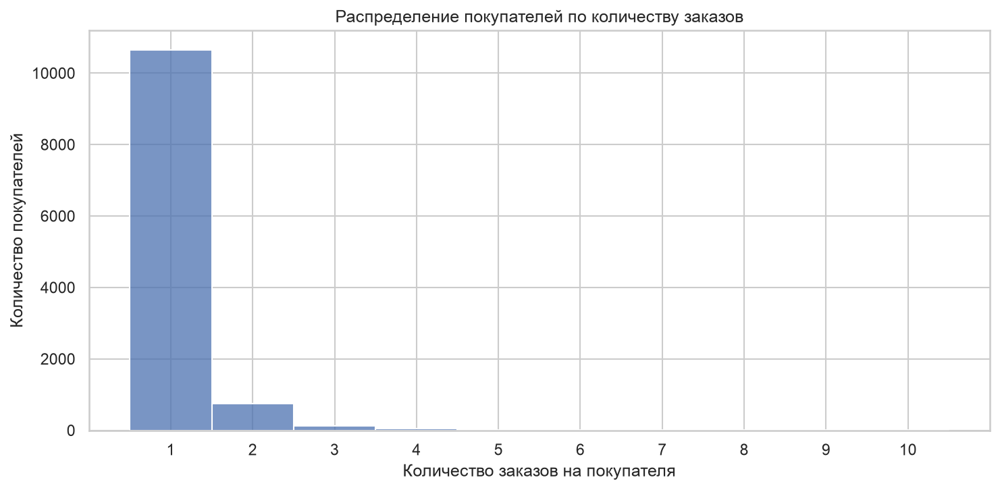
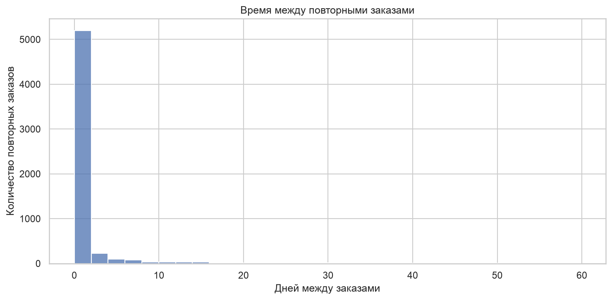
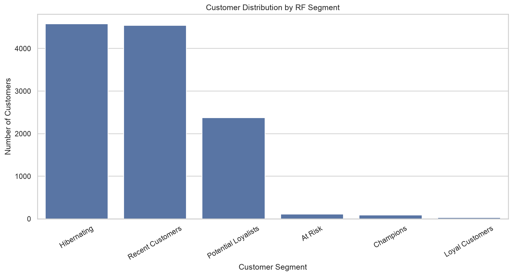
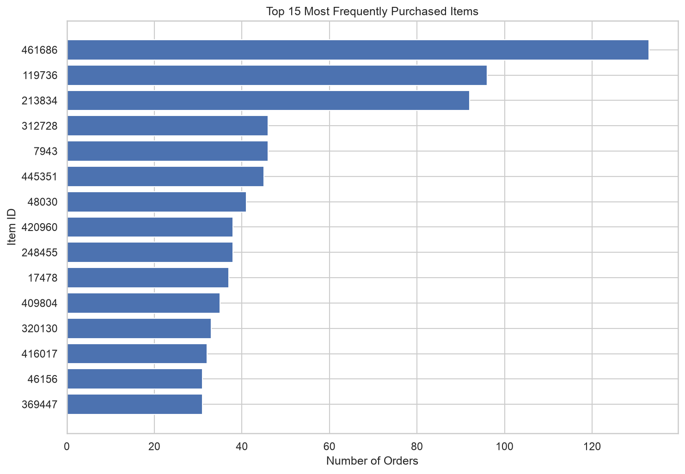

# Repeat Purchases, RFM & Product Recommendations

## 1. Цель

Задача — разобрать три вещи: повторные покупки (сколько покупателей возвращаются и как часто), RF-сегментацию покупателей и совместные покупки товаров. Плюс собрать простой прототип рекомендаций на основе ассоциаций.

Источник — `events.csv`. В работе используются `view`, `addtocart` и `transaction`. Для заказов везде берётся `transactionid`, а не количество строк `transaction`: одна транзакция может содержать несколько товарных записей, и если считать по строкам, получится завышение.

## 2. Данные и структура заказов

| Показатель | Значение |
|---|---:|
| Всего событий | 2 756 101 |
| Уникальных пользователей | 1 407 580 |
| Уникальных товаров | 235 061 |
| Событий `transaction` | 22 457 |
| Уникальных `transactionid` (заказов) | 17 672 |
| Покупателей с хотя бы одним заказом | 11 719 |
| Уникальных товаров в транзакциях | 12 025 |
| Уникальных пар покупатель — товар | 21 270 |

Проверено: пропущенных `transactionid` нет, дублирующихся строк транзакций нет, каждый `transactionid` связан ровно с одним `visitorid`. Поэтому `transactionid` принимается за идентификатор заказа.

Характеристики заказов:

| Характеристика | Значение |
|---|---:|
| Среднее число уникальных товаров в заказе | 1,263 |
| Медиана товаров в заказе | 1 |
| Заказов с несколькими товарами | 2 643 (14,96%) |
| Заказов с одним товаром | 15 029 (85,04%) |
| Максимум товаров в одном заказе | 31 |

Ключевая деталь для всех дальнейших выводов: 85% заказов — это одна позиция. Из-за этого всё, что связано с совместными покупками и market basket, будет заведомо ограничено — большинству заказов просто не из чего складывать пары.

## 3. Повторные покупки

| Показатель | Значение |
|---|---:|
| Покупатели | 11 719 |
| С одним заказом | 10 656 (90,93%) |
| Повторные | 1 063 (9,07%) |
| Всего заказов | 17 672 |
| Среднее заказов на покупателя | 1,508 |
| Медиана заказов на покупателя | 1 |
| Максимум заказов на покупателя | 502 |

Повторных покупателей всего 9,07%, но на них приходится 7 016 заказов — 39,70% от всех. Покупатели с одним заказом дают 10 656 заказов, то есть 60,30%. То есть почти 40% всей покупательской активности сконцентрировано в маленькой группе.

У одного пользователя 502 заказа за период с 11 июня по 17 сентября. По медиане это выброс (она равна 1), но покупки растянуты на три месяца — это не «всё за один день», а действительно высокоактивный профиль. Автоматически такие наблюдения не удаляются: они дают заметный вклад в средние, но без дополнительных данных объявить их техническим артефактом нельзя. При интерпретации среднего числа заказов (1,508) надо помнить, что оно раздуто такими профилями.

Обратная сторона той же картины: медиана равна 1, то есть половина покупателей ограничилась ровно одним заказом. Это не «проблема удержания» в чистом виде — по этим данным нельзя сказать, ушли они или просто больше не покупали за 4,5 месяца наблюдения. Но это точно самое заметное ограничение сегмента: доля повторных покупок низкая, и основная часть заказов делается небольшой группой.

## 4. Частота покупок и интервалы между заказами

| Показатель | Значение |
|---|---:|
| Количество интервалов | 5 953 |
| Среднее | 2,1078 дня |
| Медиана | 0,0369 дня (~53 минуты) |
| 25-й перцентиль | 0,0133 дня |
| 75-й перцентиль | 0,1778 дня (~4,27 часа) |
| 90-й перцентиль | 3,2553 дня |
| 95-й перцентиль | 10,9941 дня |
| 99-й перцентиль | 47,5522 дня |
| Максимум | 112,4770 дня |

Интервалы считаются между последовательными `transactionid` одного пользователя. Число интервалов (5 953) — это сумма заказов сверх первого у повторных покупателей.

Распределение скошено вправо: медиана около 53 минут, среднее — около 2,1 дня. То есть типичный интервал между заказами одного покупателя — менее часа, но небольшое число длинных пауз тянет среднее вверх.

Здесь важна осторожность в интерпретации. 53 минуты — это не «клиент вернулся в магазин через час». Скорее всего, это несколько `transactionid`, зарегистрированных подряд в рамках одной сессии оформления — например, по разным товарам или через несколько корзин. Без данных о логике оформления заказа и `session_id` отличить «вернулся» от «дозаказал в той же сессии» нельзя. Поэтому интервал — это буквально время между зарегистрированными заказами, и не больше.

## 5. RF-сегментация

Классический RFM требует Monetary — денежной суммы. В `events.csv` нет цен, выручки и суммы заказа, поэтому Monetary посчитать невозможно. Вместо полного RFM выполнена RF-сегментация по Recency и Frequency. Количество уникальных купленных товаров добавлено как дополнительная характеристика Product Breadth, но не как замена денежной метрики.

Recency — дни от последнего заказа покупателя до последнего timestamp в датасете (18.09.2015, 02:59:47 UTC). Для R используется квинтильная шкала с обратным направлением: 5 — самая недавняя покупка, 1 — самая давняя. Для F — фиксированные пороги: 1 заказ → 1; 2 → 2; 3 → 3; 4–5 → 4; 6 и более → 5.

### Результаты сегментации

| RF-сегмент | Покупателей | Доля | Среднее Recency, дни | Среднее число заказов |
|---|---:|---:|---:|---:|
| Hibernating | 4 580 | 39,08% | 110,61 | 1,07 |
| Recent Customers | 4 541 | 38,75% | 30,02 | 1,07 |
| Potential Loyalists | 2 374 | 20,26% | 69,35 | 1,14 |
| At Risk | 108 | 0,92% | 108,79 | 14,59 |
| Champions | 85 | 0,73% | 23,52 | 33,93 |
| Loyal Customers | 31 | 0,26% | 68,38 | 25,39 |
| **Итого** | **11 719** | **100,00%** | — | — |

Основная масса — Hibernating и Recent Customers, вместе 77,83%. При этом обе группы имеют среднее число заказов 1,07 — то есть это фактически «купил один раз, давно» и «купил один раз, недавно». Разница между ними только в давности, а не в частоте.

Сегменты с высокой частотой (At Risk, Champions, Loyal Customers) в сумме дают всего 224 покупателя — менее 2%. Но у них среднее число заказов 14,59 / 33,93 / 25,39 соответственно. Это как раз те, кто даёт основную часть заказов: 9,07% повторных покупателей, о которых шла речь в §3, почти целиком сидят в этих трёх сегментах.

Несколько оговорок по сегментации:

- Пороги выбраны вручную, это не универсальная классификация. При других границах R и F разбиение изменится.
- Период наблюдения — примерно 4,5 месяца. Поэтому Hibernating — это не «ушедшие клиенты», а «покупавшие давно по меркам этого датасета». Называть их churn без дополнительных данных неверно.
- Monetary не учтён, поэтому все сегменты — про поведение (давность и частота), а не про ценность. Покупатель из Champions с 33 заказами и покупатель из Hibernating с одним заказом могут приносить совершенно разную выручку, но в этой таблице они различаются только по числу заказов, а не по деньгам.

## 6. Совместные покупки

Товары группируются по `transactionid`, повторяющиеся `itemid` внутри одного заказа предварительно удаляются. Из 17 672 заказов 2 643 содержат более одного уникального товара — это те 14,96% из §2, на которых вообще можно искать пары.

Найдено 9 688 уникальных пар товаров. После фильтра по минимум 5 совместным заказам остаётся 12 пар. При пороге 10 заказов — одна пара.

### Чувствительность к порогу

| Минимум совместных заказов | Пар |
|---:|---:|
| 2 | 903 |
| 3 | 79 |
| 5 | 12 |
| 10 | 1 |
| 15 | 1 |
| 20 | 1 |
| 30 | 1 |

Быстрое падение 903 → 79 → 12 → 1 показывает, насколько оценки редких пар нестабильны. При пороге 2 любая случайная пара из двух заказов уже считается «совместной покупкой», а при пороге 5 остаётся всего 12 пар, и большинство из них опирается на очень малое число наблюдений. Строить рекомендации на таких данных рискованно.

### Наиболее заметная пара

| Метрика | 213834 → 445351 | 445351 → 213834 |
|---|---:|---:|
| Совместные заказы | 39 | 39 |
| Support | 0,22% | 0,22% |
| Confidence | 42,39% | 86,67% |
| Lift | 166,48 | 166,48 |

Пара 213834 и 445351 — самая частая среди найденных. Встречается в 39 заказах. Из заказов с товаром 445351 около 86,67% содержат также товар 213834; в обратном направлении Confidence 42,39%. Это асимметрия условных вероятностей, а не противоречие: 445351 почти всегда идёт «в комплекте» с 213834, а 213834 покупают и без 445351.

Support 0,22% означает, что эта пара встречается в 0,22% от всех заказов — доля маленькая, но Lift 166,48 показывает, что это в 166 раз чаще случайного. Для рекомендаций важнее как раз Confidence: если пользователь уже добавил 445351, у него высокий шанс, что он возьмёт и 213834.

Про высокие Lift у других пар: например, 2 524,57 для пары 28789 и 132633 — но это всего 5 совместных заказов. Такие значения нестабильны и при добавлении пары новых заказов могут упасть в разы. Ранжировать пары только по Lift нельзя — надо смотреть на Support и абсолютную частоту в том числе.

## 7. Прототип рекомендаций

Построен простой association-based прототип: если товар A есть в истории покупок, предлагается товар B, если они встречались в одном заказе. Направленные правила ранжируются по Confidence и числу совместных заказов. При более строгом варианте (минимум 10 совместных заказов) в текущих данных остаётся только пара 213834 и 445351 в двух направлениях.

Это исследовательский прототип, а не готовая рекомендательная система. Ограничения:

- правила не персонализированы — не учитывают историю конкретного пользователя;
- не используются просмотры и последовательность событий, только совместные покупки;
- нет цен, маржинальности и доступности товара;
- нет проверки на отложенной выборке или в A/B-эксперименте.

Для прототипа этого достаточно, для продакшена — нет.

## 8. Основные выводы

1. **Повторные покупатели дают непропорционально много заказов.** 9,07% покупателей обеспечивают 39,70% заказов. Это самая заметная цифра во всём отчёте, и она же — главный аргумент в пользу того, чтобы разбираться с удержанием.
2. **Большинство покупателей — однозаказные.** 90,93% покупателей сделали один заказ. Причины по этим данным не установить: нет ни маркетинговых касаний, ни данных о цене и ассортименте.
3. **Высокочастотные клиенты малочисленны, но именно они держат заказы.** At Risk + Champions + Loyal Customers — 224 человека, менее 2% от всех покупателей. Один профиль с 502 заказами за три месяца стоит проверить отдельно — на предмет технической аномалии или реального «оптового» покупателя.
4. **Совместные покупки — редкость.** Только 14,96% заказов содержат больше одного товара. Это ограничивает market basket: большинство заказов в принципе не дают пары.
5. **Единственная пара-кандидат для рекомендаций — 213834 и 445351.** 39 совместных заказов, Confidence 86,67% в направлении 445351 → 213834. Её практическая ценность должна проверяться экспериментом, а не выводиться из Lift.

## 9. Ограничения

- **Нет Monetary.** Ни AOV, ни выручки, ни маржинальности. RF-сегменты описывают давность и частоту, но не ценность клиента.
- **RF-сегментация зависит от порогов.** Квинтили для R и фиксированные границы для F выбраны вручную. При других порогах разбиение изменится.
- **Период 4,5 месяца.** Крайние календарные периоды неполные, а «Hibernating» на таком горизонте — не подтверждённый churn.
- **Recency до последнего timestamp.** Дата окончания датасета (18.09.2015) — это не «сегодня». Recency сдвинется, если выгрузка будет обновлена.
- **Нет названий и категорий товаров.** Пары представлены только `itemid`, что ограничивает интерпретацию.
- **Редкие пары нестабильны.** При пороге 5 совместных заказов остаётся 12 пар, при пороге 10 — одна. Высокие Lift на малых числах могут быть случайными.
- **Ассоциация ≠ причинность.** Совместная покупка двух товаров не означает, что покупка одного увеличивает вероятность покупки другого. Для проверки нужен эксперимент.
- **Рекомендации не тестировались.** Ни на отложенной выборке, ни в A/B.

## 10. Итог

Коротко:

- 9,07% покупателей дают 39,70% заказов. Повторные покупки сконцентрированы в маленькой группе — это самая значимая цифра отчёта.
- 90,93% покупателей — однозаказные. Медиана заказов на покупателя — 1, среднее 1,508 раздуто небольшим числом очень активных профилей (до 502 заказов).
- RF-сегментация подтверждает ту же картину: 77,83% покупателей — в Hibernating и Recent Customers, и у обоих среднее число заказов 1,07. Высокочастотные сегменты (At Risk, Champions, Loyal Customers) — 224 человека, но именно они держат основную часть заказов.
- Совместные покупки — редкость: только 14,96% заказов содержат больше одного товара. Единственная пара с устойчивой поддержкой — 213834 и 445351, 39 совместных заказов, Confidence 86,67% в одном направлении.
- Прототип рекомендаций на этой паре можно строить, но проверять только экспериментом. Без Monetary оценить денежный эффект рекомендаций нельзя, даже если конверсия в дополнительный товар вырастет.
