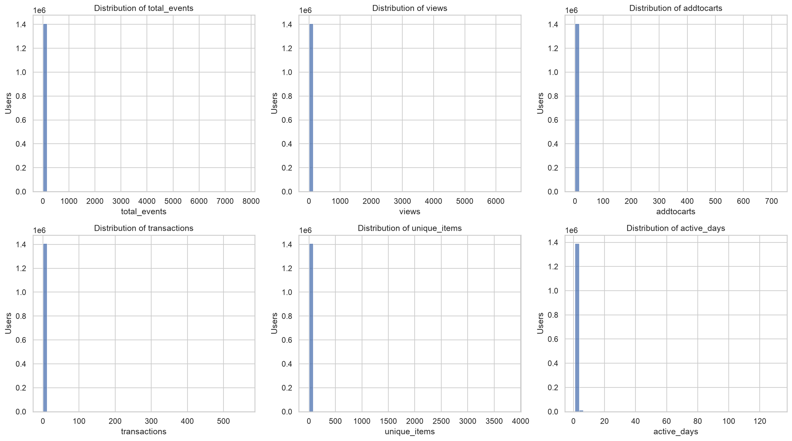
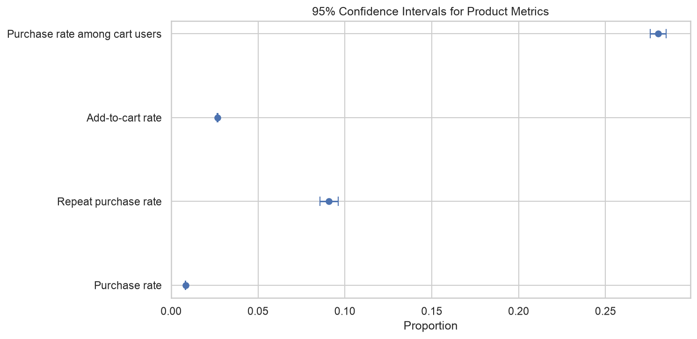
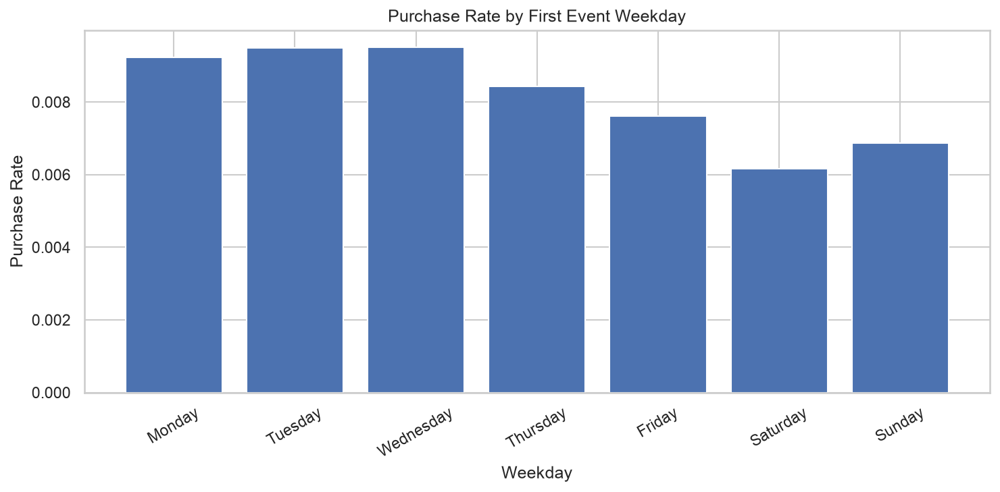
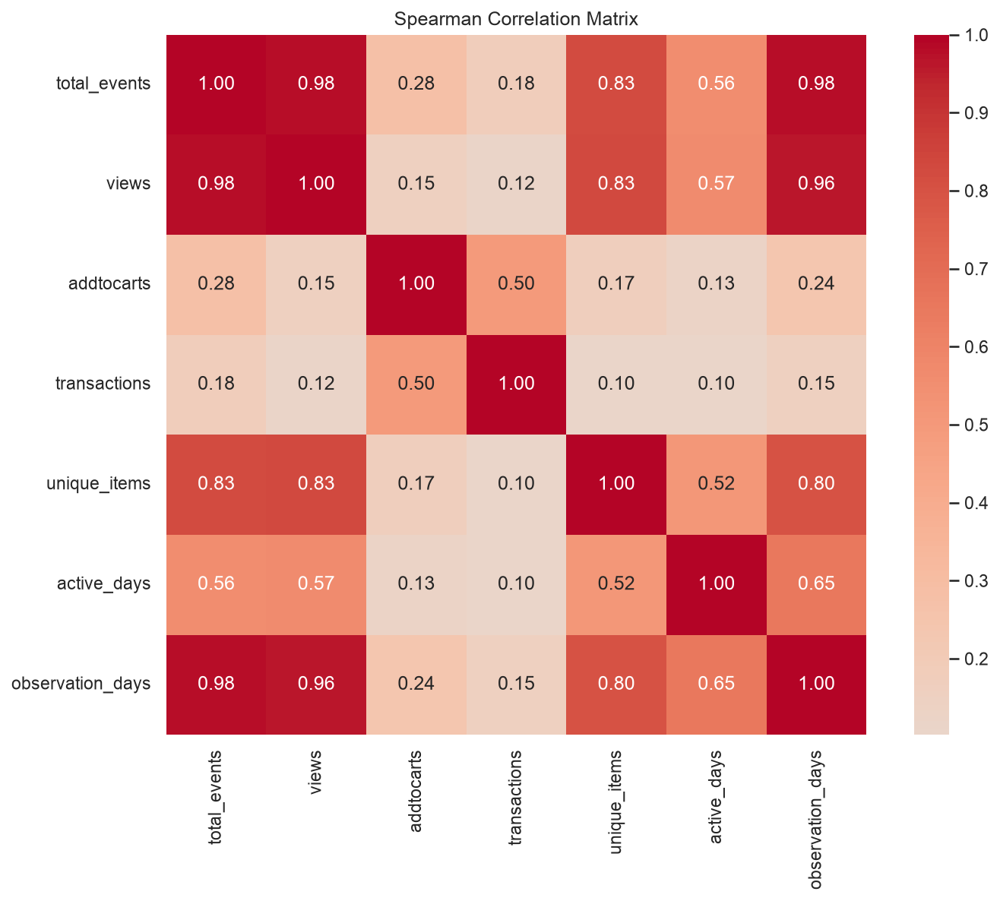
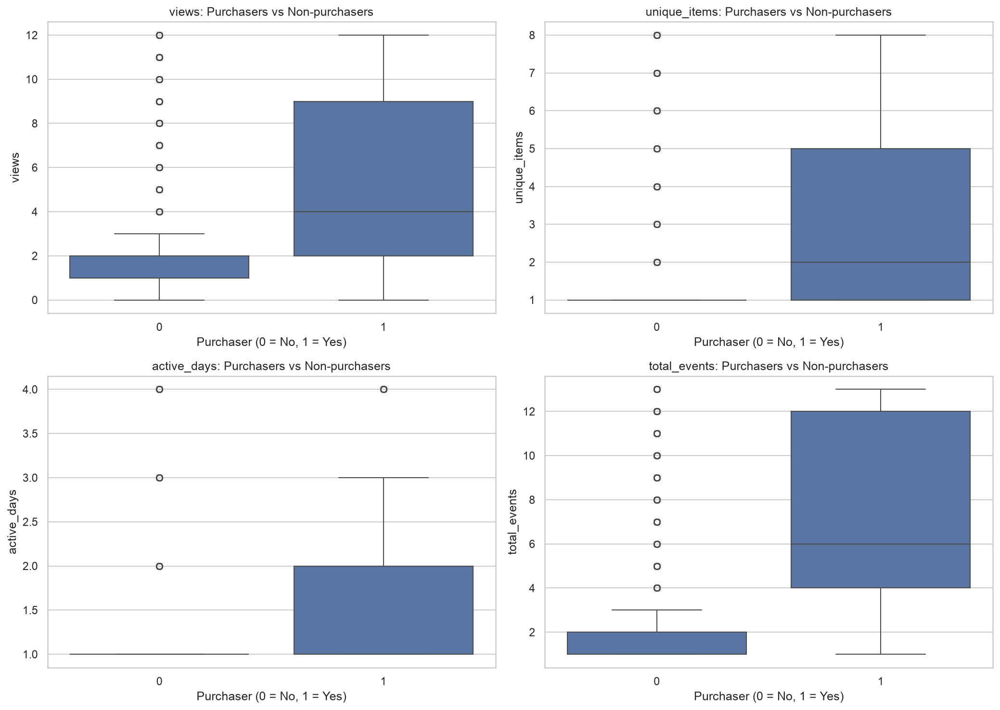

# Statistics & Statistical Inference Report

## 1. О проекте

**Проект:** E-commerce Product Analytics
**Датасет:** `events.csv`
**Период:** 03.05.2015 — 18.09.2015
**Событий:** 2 756 101
**Пользователей:** 1 407 580

Задача — применить описательную статистику и статвывод к пользовательским метрикам: посмотреть распределения, оценить доверительные интервалы продуктовых метрик, проверить гипотезы о различиях между покупателями и непокупателями и найти корреляции между показателями активности.

## 2. Подготовка данных

События агрегированы на уровне `visitorid`. Для каждого пользователя рассчитаны:

- `total_events` — общее число событий;
- `views` — просмотры;
- `addtocarts` — добавления в корзину;
- `transactions` — события покупки;
- `unique_items` — число уникальных товаров, с которыми было взаимодействие;
- `first_event` / `last_event` — первое и последнее событие;
- `active_days` — число дней с активностью;
- `observation_days` — длительность наблюдения в днях;
- `is_purchaser` — бинарный признак наличия хотя бы одного `transaction`.

Дополнительно посчитано число уникальных заказов (`orders_count`) по `transactionid`. Повторный покупатель — тот, у кого больше одного уникального заказа.

Проверка таблицы: 1 407 580 строк, столько же уникальных `visitorid`, пропусков нет, одна строка — один пользователь.

## 3. Описательная статистика

| Метрика | Mean | Median | P90 | P95 | P99 | Max |
|---|---:|---:|---:|---:|---:|---:|
| Total events | 1,958 | 1 | 3 | 5 | 13 | 7 757 |
| Views | 1,893 | 1 | 3 | 5 | 12 | 6 479 |
| Add to carts | 0,049 | 0 | 0 | 0 | 1 | 719 |
| Transactions | 0,016 | 0 | 0 | 0 | 0 | 559 |
| Unique items | 1,524 | 1 | 2 | 3 | 8 | 3 814 |
| Active days | 1,172 | 1 | 2 | 2 | 4 | 131 |
| Observation days | 2,375 | 0 | 0,480 | 10,31 | 69,089 | 137,973 |

Распределения по всем метрикам сильно смещены вправо. Медиана по большинству показателей — 1, а среднее заметно выше, потому что его тянут вверх пользователи с сотнями и тысячами событий. Максимум в 7 757 событий у одного пользователя — это в 4 000 раз больше медианы.

Практический вывод: в следующих разделах опираюсь на медиану и перцентили. Среднее по `total_events`, равное 1,958, не описывает типичного пользователя — оно ближе к «среднему по тем, кто активен», а не по всей аудитории.

## 4. Доверительные интервалы для долей — метод Wilson

Для биномиальных долей посчитаны 95% интервалы методом Wilson — он работает и при малых пропорциях, в отличие от нормального приближения.

| Метрика | Successes | Total | Rate | 95% CI |
|---|---:|---:|---:|---:|
| Purchase rate | 11 719 | 1 407 580 | 0,83% | 0,82–0,85% |
| Repeat purchase rate | 1 063 | 11 719 | 9,07% | 8,56–9,60% |
| Add-to-cart rate | 37 722 | 1 407 580 | 2,68% | 2,65–2,71% |
| Purchase rate among cart users | 10 576 | 37 722 | 28,04% | 27,59–28,49% |

Коротко по каждой:

- **Purchase rate 0,83%** — доля пользователей, совершивших хотя бы одну покупку за весь период.
- **Repeat purchase rate 9,07%** — доля тех, кто сделал больше одного уникального заказа, среди покупателей.
- **Add-to-cart rate 2,68%** — доля пользователей, хоть раз добавивших товар в корзину.
- **Purchase rate among cart users 28,04%** — доля покупателей среди тех, кто добавлял в корзину. Важная оговорка: покупка не обязательно относилась к тому же товару, что был в корзине.

Интервалы узкие — данные большие, 1,4 млн пользователей. Даже для repeat purchase rate с 1 063 успехами ширина интервала около 1 процентного пункта.

## 5. Bootstrap-интервалы

Дополнительно посчитаны доверительные интервалы для среднего и медианы через Bootstrap. Параметры: подвыборка 100 000 пользователей без возвращения, 2 000 повторов с возвращением, 95% уровень.

| Метрика | Statistic | Estimate | 95% CI |
|---|---|---:|---:|
| Total events | Mean | 1,957 | 1,901–2,027 |
| Total events | Median | 1,000 | 1,000–1,000 |
| Views | Mean | 1,890 | 1,842–1,951 |
| Views | Median | 1,000 | 1,000–1,000 |
| Active days | Mean | 1,171 | 1,166–1,176 |
| Active days | Median | 1,000 | 1,000–1,000 |

По средним интервалы более-менее содержательные — например, по total_events 1,901–2,027. По медианам интервал везде [1, 1], потому что медиана в выборке устойчиво равна 1. Это не баг, а отражение того, что больше половины пользователей совершают ровно одно действие.

Оговорка: расчёт на подвыборке 100 000, а не на всех 1 407 580. Интервалы приближённые. Для средних это не критично (при таком объёме выборки оценка стабильна), но для метрик с тяжёлым хвостом — вроде `total_events` с максимумом 7 757 — подвыборка может «потерять» самых активных пользователей и занизить верхнюю границу.

## 6. Mann–Whitney U: покупатели vs непокупатели

Сравниваются две группы:

| Группа | Пользователей |
|---|---:|
| Non-purchasers | 1 395 861 |
| Purchasers | 11 719 |

Критерий непараметрический, потому что распределения сильно скошены и t-test по средним здесь был бы некорректен.

| Метрика | Median non-purch. | Median purch. | Mean non-purch. | Mean purch. | Rank-biserial |
|---|---:|---:|---:|---:|---:|
| Total events | 1 | 6 | 1,809 | 19,684 | 0,8954 |
| Views | 1 | 4 | 1,779 | 15,424 | 0,5817 |
| Unique items | 1 | 2 | 1,457 | 9,538 | 0,4610 |
| Active days | 1 | 1 | 1,162 | 2,337 | 0,3413 |
| Observation days | 0 | 0,0697 | 2,308 | 10,366 | 0,7794 |

Все пять p-value очень малы, поправка Benjamini–Hochberg их не «убивает». Программа выводит `p = 0.0` — это артефакт численной точности, в интерпретации `p < 0,001`.

По размеру эффекта (rank-biserial) картина такая:

- **total_events — 0,8954**, самый большой разрыв. Но здесь есть механическая часть: в `total_events` входят сами транзакции, по которым определяется группа. Покупатель по определению имеет хотя бы одно событие покупки, которого у непокупателя нет.
- **observation_days — 0,7794**. Покупатели дольше находятся в датасете. Отчасти это тоже механически: чтобы купить, нужно провести в системе хоть какое-то время.
- **views — 0,5817**. Разрыв меньше, но всё ещё заметный. Покупатели просматривают больше товаров.
- **unique_items — 0,4610** и **active_days — 0,3413** — различия есть, но скромнее.

Что это даёт. Покупатели активнее по всем метрикам, и это статистически надёжно. Но направление связи по этим данным не установить: активность приводит к покупке или покупка «заставляет» пользователя быть активным — это разные вещи, и по кросс-секционным данным их не разделить. Скорее всего, работает и то, и другое одновременно.

## 7. χ²: доля покупок по дню недели первого события

Проверяется связь между днём недели первого события пользователя и фактом покупки.

| День | Non-purchasers | Purchasers | Purchase rate |
|---|---:|---:|---:|
| Monday | 221 126 | 2 062 | 0,92% |
| Tuesday | 222 604 | 2 132 | 0,95% |
| Wednesday | 214 915 | 2 062 | 0,95% |
| Thursday | 208 840 | 1 777 | 0,84% |
| Friday | 192 154 | 1 474 | 0,76% |
| Saturday | 160 255 | 994 | 0,62% |
| Sunday | 175 967 | 1 218 | 0,69% |

Статистика:

- χ² = 244,3673
- df = 6
- p = 6,5527 × 10⁻⁵⁰
- Cramér's V = 0,0132
- Минимальная ожидаемая частота — 1 342,50 (условие применимости выполнено)

Формально различие высоко значимо. Но Cramér's V = 0,0132 — это практически ноль. При 1,4 млн пользователей даже мизерные различия дают крошечный p-value, и здесь именно этот случай: max (0,95%) и min (0,62%) различаются в 1,5 раза, но в абсолютных числах это менее 0,5 процентного пункта.

Практически: день недели первого события не имеет смысла использовать как фактор для прогноза покупки. Связь статистически есть, но объяснительной силы у неё почти нет.

Ещё одна оговорка по смыслу: «первое событие в датасете» — это не «день регистрации» и не «первое взаимодействие с магазином». Если у пользователя история обрезана, он может попасть в понедельник, хотя реально пришёл в другой день. Это может давать смещение, особенно для майской когорты — см. отчёт 04.

## 8. Корреляция Спирмена

Метод выбран из-за скошенных распределений — он ловит монотонную связь, а не только линейную, и не требует нормальности.

### Матрица корреляций

| Метрика | Total events | Views | Add to carts | Transactions | Unique items | Active days | Observation days |
|---|---:|---:|---:|---:|---:|---:|---:|
| Total events | 1,000 | 0,981 | 0,275 | 0,177 | 0,826 | 0,561 | 0,978 |
| Views | 0,981 | 1,000 | 0,153 | 0,115 | 0,829 | 0,566 | 0,962 |
| Add to carts | 0,275 | 0,153 | 1,000 | 0,498 | 0,167 | 0,126 | 0,236 |
| Transactions | 0,177 | 0,115 | 0,498 | 1,000 | 0,103 | 0,102 | 0,153 |
| Unique items | 0,826 | 0,829 | 0,167 | 0,103 | 1,000 | 0,516 | 0,800 |
| Active days | 0,561 | 0,566 | 0,126 | 0,102 | 0,516 | 1,000 | 0,654 |
| Observation days | 0,978 | 0,962 | 0,236 | 0,153 | 0,800 | 0,654 | 1,000 |

### Отдельные проверки

| Метрика 1 | Метрика 2 | Спирмен |
|---|---|---:|
| Views | Add to carts | 0,1534 |
| Views | Transactions | 0,1155 |
| Add to carts | Transactions | 0,4979 |
| Total events | Unique items | 0,8258 |
| Active days | Total events | 0,5614 |

Все пять проверок значимы после поправки Benjamini–Hochberg. Нулевые p-value в выводе — это те же «очень малые значения», а не буквальный ноль.

### Что видно

**Сильные корреляции (0,8+):**

- `total_events` ↔ `observation_days` — 0,978;
- `views` ↔ `observation_days` — 0,962;
- `views` ↔ `unique_items` — 0,829;
- `total_events` ↔ `unique_items` — 0,826.

Первые две — почти тавтология: чем дольше пользователь в датасете, тем больше событий он успевает сделать. Если пользователь провёл в системе 130 дней, у него в среднем событий будет больше, чем у того, кто был 2 дня. Это не «связь», это в значительной мере отражение того, как устроен подсчёт.

Корреляции с `unique_items` интереснее: они говорят, что пользователи с высокой активностью не концентрируются на одном товаре, а смотрят много разных. Это уже содержательное наблюдение, а не артефакт.

**Умеренная корреляция:**

- `addtocarts` ↔ `transactions` — 0,498. Из всех пар с участием транзакций это самая заметная. Логично: чтобы купить, надо добавить в корзину, и наоборот — кто добавляет в корзину, чаще покупает.

**Слабые корреляции:**

- `views` ↔ `addtocarts` — 0,153;
- `views` ↔ `transactions` — 0,115.

Самое важное наблюдение: просмотры сами по себе почти не связаны с покупками. Пользователь может просмотреть десятки товаров и ничего не купить — это видно и в EDA (`187946` с 2 911 просмотревшими и 0 покупок), и здесь, в матрице.

Общая оговорка: корреляция не доказывает причинность, и часть высоких значений здесь — следствие того, что метрики считаются по одним и тем же событиям. `total_events` включает `views`, `addtocarts` и `transactions` — это механическая связь, а не «влияние».

## 9. Покупатели vs непокупатели: визуальное сравнение

Для наглядности построены boxplot по четырём метрикам: `views`, `unique_items`, `active_days`, `total_events`. Верхние значения ограничены 99-м перцентилем — иначе выбросы растягивают график и разница между медианами не видна.

Что видно:

- Медиана числа событий у покупателей выше;
- Покупатели просматривают больше товаров;
- Покупатели взаимодействуют с большим числом уникальных товаров;
- Средняя продолжительность активности у покупателей выше.

Визуально картина совпадает с тем, что показывает Mann–Whitney U. Никаких сюрпризов — просто более наглядное представление того же результата.

## 10. Ключевые цифры

| Метрика | Значение |
|---|---:|
| Total users | 1 407 580 |
| Purchasers | 11 719 |
| Purchase rate | 0,83% |
| Mean events per user | 1,958 |
| Median events per user | 1 |
| Mean views per user | 1,893 |
| Median views per user | 1 |
| Mean active days | 1,172 |
| Median active days | 1 |

Главное, что стоит вынести из этих чисел:

- Пользовательская активность крайне неоднородна. Медиана 1 событие, среднее около 2, но есть пользователи с тысячами событий. Среднее — плохая характеристика типичного пользователя.
- Purchase rate 0,83% — низкая, но в датасете с просмотрами это нормально. Среди тех, кто дошёл до корзины, покупку совершают уже 28,04%.
- Repeat purchase rate 9,07% — большинство покупателей ограничиваются одним заказом.

## 11. Ограничения

- **Нет временной причинности.** Все метрики агрегированы за весь период. Утверждать «активность приводит к покупке» по этим данным нельзя — только «покупатели в среднем активнее».
- **Разная длительность наблюдения.** Кто-то в датасете 130 дней, кто-то 2. Средние по `total_events` и `observation_days` смешивают пользователей с очень разным временем в системе.
- **Механические корреляции.** `total_events` включает в себя `views`, `addtocarts` и `transactions` — высокие корреляции с ними в значительной мере тавтологичны.
- **Bootstrap на подвыборке.** 100 000 из 1 407 580 — это 7%. Оценки стабильны, но для тяжёлых хвостов (вроде `total_events` с max 7 757) подвыборка может занижать верхнюю границу.
- **Множественные проверки.** Для серий статистических тестов применена поправка Benjamini–Hochberg, но с 1,4 млн наблюдений даже без поправки почти всё значимо.
- **Большая выборка — ловушка.** При 1,4 млн пользователей практически любой эффект статистически значим. Пример — χ² по дню недели: p-value 10⁻⁵⁰, но Cramér's V = 0,0132. Надо смотреть на размер эффекта, а не на p-value.
- **Нет выручки.** AOV, GMV, LTV, Monetary — по этим данным не считаются, потому что нет цен.

## 12. Итог

Что показала статистика:

- Все пользовательские метрики имеют тяжёлый правый хвост. Медиана по большинству — 1, средние раздуты небольшим числом очень активных пользователей.
- Purchase rate 0,83%, repeat purchase rate 9,07%, add-to-cart rate 2,68%. Среди тех, кто добавлял в корзину, покупают 28,04%.
- Покупатели активнее непокупателей по всем пяти метрикам (Mann–Whitney). Самый большой разрыв по `total_events` (rank-biserial 0,8954) — но он частично механический, потому что `total_events` включает сами транзакции.
- День недели первого события связан с покупкой формально (p ≈ 10⁻⁵⁰), но эффект крошечный (Cramér's V = 0,0132). Практической ценности нет.
- Самые сильные корреляции — между `total_events`, `views` и `observation_days` (0,8–0,98). Но часть этих связей тавтологична: чем дольше пользователь в датасете, тем больше у него событий.
- Самое содержательное наблюдение из корреляций: `views` и `transactions` связаны слабо (0,115). Просмотры сами по себе почти не предсказывают покупку.
