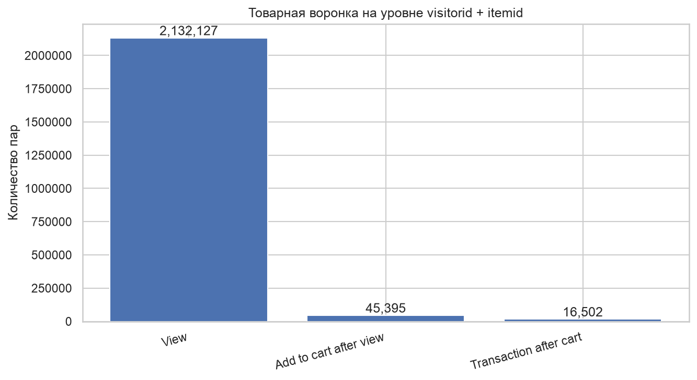
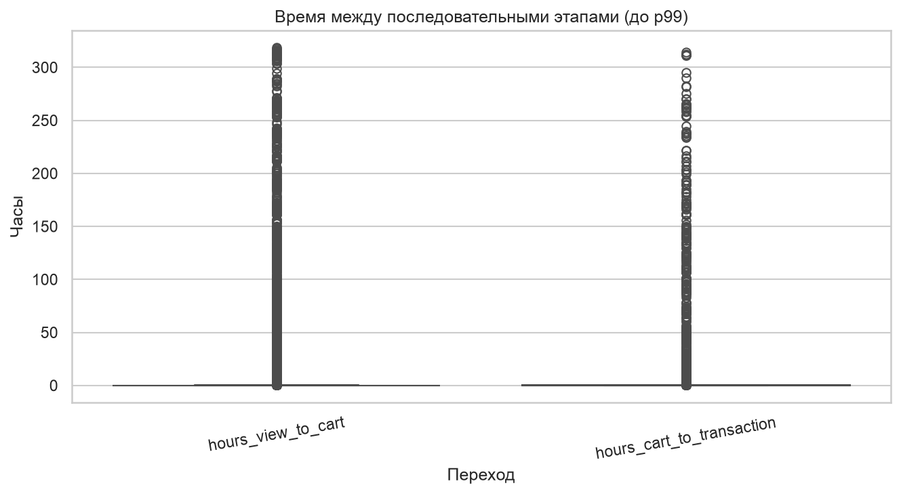
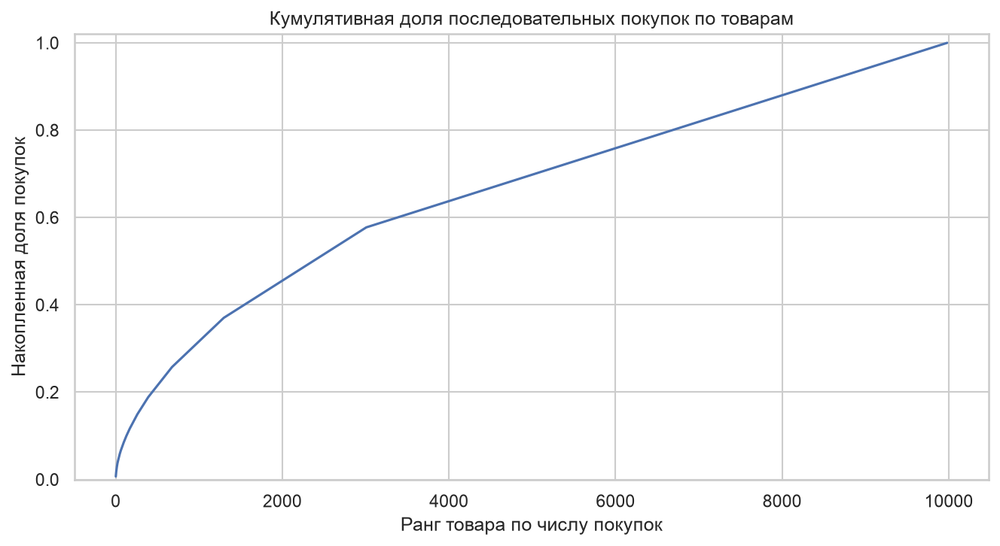
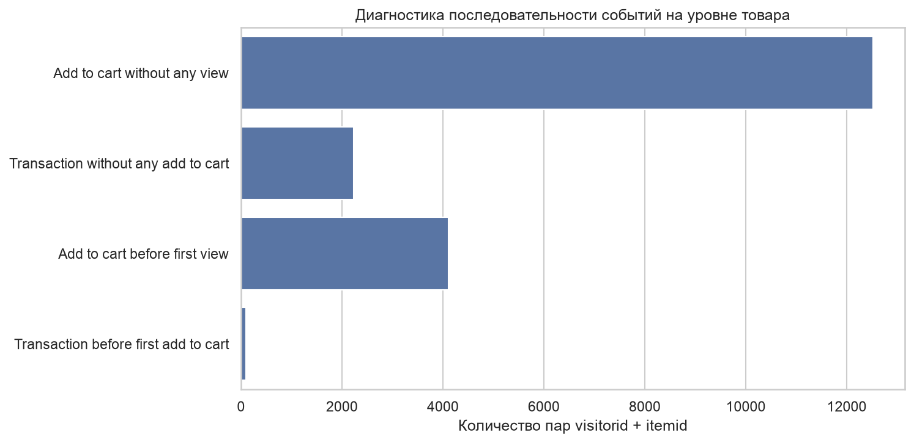

# Advanced Behavioral Analytics Report

## 1. Цель

Задача — посмотреть на поведение не на уровне пользователя, а на уровне пары **visitorid + itemid**. То есть отследить, как один человек взаимодействует с одним конкретным товаром: смотрит, добавляет в корзину, покупает. Отдельно — повторные просмотры, задержки между этапами и концентрация покупок по товарам.

## 2. Данные и метод

### 2.1. Общая информация

| Показатель | Значение |
|---|---:|
| Строк | 2 756 101 |
| Столбцов | 5 |
| Период | 03.05.2015 03:00:04 — 18.09.2015 02:59:47 UTC |
| Уникальных пользователей | 1 407 580 |
| Уникальных товаров | 235 061 |

События:

| Тип | Количество |
|---|---:|
| `view` | 2 664 312 |
| `addtocart` | 69 332 |
| `transaction` | 22 457 |

### 2.2. Единица анализа

Основная единица — пара `visitorid + itemid`. Всего в данных **2 145 179 уникальных пар**.

Важно: пара visitor-item — это не заказ и не покупка. Один пользователь может взаимодействовать с десятками товаров, а один товар — с тысячами пользователей. Строки `transaction` тоже не равны уникальным заказам: одна транзакция может содержать несколько товаров.

### 2.3. Как определяется последовательность

Для каждой пары берутся первые временные отметки:

- `first_view` — первый просмотр товара;
- `first_addtocart` — первое добавление товара в корзину;
- `first_transaction` — первая транзакция по товару.

Последовательность считается соблюдённой, если первое событие предыдущего этапа раньше первого события следующего:

- View → Add to cart;
- Add to cart → Transaction;
- View → Add to cart → Transaction.

Это воронка именно по паре visitor-item. Она не пользовательская и не сессионная: переходы между разными товарами здесь не учитываются.

### 2.4. Временное окно

Воронка строится на всём периоде наблюдения. Максимальное время между этапами не ограничивается. Поэтому пользователь мог посмотреть товар в мае, а добавить его в корзину в августе — если оба события попали в датасет, пара засчитывается.

## 3. Товарная воронка

| Этап | Пар | Конверсия от предыдущего | Конверсия от View |
|---|---:|---:|---:|
| View | 2 132 127 | 100,00% | 100,00% |
| Add to cart после View | 45 395 | 2,13% | 2,13% |
| Transaction после Cart | 16 502 | 36,35% | 0,77% |

Из 2 132 127 пар с просмотром до добавления в корзину доходят 45 395 — конверсия 2,13%. Из тех, кто прошёл View → Cart, до транзакции доходят 16 502 — конверсия 36,35%. Итоговая View → Transaction — 0,77%.

Главный барьер — переход от просмотра к корзине. После корзины воронка «держит» гораздо лучше: больше трети пар доходят до покупки.

Одна деталь, которую стоит держать в голове: в отчёте 03 на уровне пары указаны другие числа — 45 810 добавлений и 16 700 транзакций. Разница небольшая (415 и 198 пар), но она есть. Скорее всего, дело в разных правилах отбора пар: здесь жёстко берутся первые события и проверяется их порядок, в 03 — возможно, условия чуть мягче. Прямо сравнивать эти две таблицы нельзя, но общий вывод одинаковый: основной провал — на View → Cart.

## 4. Товарные показатели

### 4.1. Сколько товаров в анализе

В датасете 235 061 товар. Для анализа конверсий использован технический фильтр: не менее 100 пар visitor-item с просмотром. После фильтра остаётся **2 554 товара**. Это не «успешные товары», а просто товары с минимальным объёмом данных.

### 4.2. Примеры популярных товаров

| itemid | View pairs | Cart pairs | Purchase pairs | View → Cart | Cart → Purchase | View → Purchase |
|---:|---:|---:|---:|---:|---:|---:|
| 187946 | 2 911 | 0 | 0 | 0,00% | — | 0,00% |
| 5411 | 2 078 | 8 | 0 | 0,38% | 0,00% | 0,00% |
| 370653 | 1 577 | 0 | 0 | 0,00% | — | 0,00% |
| 461686 | 1 379 | 251 | 116 | 18,20% | 46,22% | 8,41% |
| 96924 | 1 359 | 0 | 0 | 0,00% | — | 0,00% |
| 219512 | 1 358 | 29 | 8 | 2,14% | 27,59% | 0,59% |
| 298009 | 1 342 | 0 | 0 | 0,00% | — | 0,00% |
| 335975 | 1 154 | 0 | 0 | 0,00% | — | 0,00% |
| 384302 | 1 143 | 36 | 13 | 3,15% | 36,11% | 1,14% |
| 151444 | 1 103 | 0 | 0 | 0,00% | — | 0,00% |

Для товаров без cart pairs конверсия Cart → Purchase не определена, поэтому стоит «—», а не ноль.

Таблица хорошо показывает главное: высокая популярность по просмотрам не гарантирует перехода к корзине. Шесть из десяти товаров в топе по просмотрам имеют ноль добавлений в корзину. При этом `461686` — противоположный пример: 1 379 просмотров, 251 добавление, 116 покупок, конверсия View → Cart 18,20%.

### 4.3. Популярность и конверсия

Корреляция Спирмена между числом пар с просмотром (`view_pairs`) и конверсией View → Purchase:

**ρ = 0,0656**

Связь очень слабая. В рамках этой выборки количество просмотров товара почти не связано с его конверсией в покупку. Это не значит, что других факторов нет — просто в данных отсутствуют цена, маржа, наличие, рекламные показы и позиции в выдаче, поэтому объяснить различия между товарами по этим данным нельзя.

## 5. Повторные просмотры

Для 2 132 127 пар с просмотром посчитано, сколько раз один пользователь смотрел один товар.

| Статистика | Просмотров |
|---|---:|
| Среднее | 1,2496 |
| Медиана | 1 |
| P75 | 1 |
| P90 | 2 |
| P95 | 2 |
| P99 | 5 |
| Максимум | 308 |

Доля пар с повторными просмотрами — **14,38%**. В остальных 85,62% товар просмотрен один раз.

Типичная картина: один просмотр на пару. Повторные просмотры — примерно каждая седьмая пара. Максимум в 308 просмотров — редкий выброс, из-за которого среднее (1,2496) выше медианы (1). Медиана и перцентили здесь лучше описывают типичное поведение.

Повторный просмотр может означать возврат к товару, сравнение вариантов или отложенное решение. Но сам по себе он не гарантирует покупку — это видно и по общему числу: повторные просмотры есть у 14,38% пар, а до покупки доходят 0,77%.

## 6. Время между этапами

| Интервал | Количество пар | Среднее, ч | Медиана, ч | P75, ч | P90, ч | P95, ч | P99, ч | Максимум, ч |
|---|---:|---:|---:|---:|---:|---:|---:|---:|
| View → Cart | 16 502 | 18,7845 | 0,0316 | 0,1757 | 7,3974 | 66,3480 | 487,0141 | 3 143,3510 |
| Cart → Transaction | 16 502 | 5,6828 | 0,0723 | 0,1854 | 0,8351 | 4,2925 | 129,8117 | 2 208,5158 |

Медианное время View → Cart — **0,0316 часа**, то есть около **1,9 минуты**. Медианное Cart → Transaction — **0,0723 часа**, около **4,3 минуты**.

При этом распределения имеют длинный правый хвост: средние заметно выше медиан, а верхние перцентили уходят в десятки и сотни часов. Для View → Cart 90% наблюдений укладываются примерно в 7,4 часа, а 99% — в 487 часов. Для Cart → Transaction соответствующие значения — около 0,84 и 129,8 часа.

Отсюда практический вывод: среднее время не описывает типичный сценарий. Медиана и перцентили дают более честную картину.

Одна оговорка по таблице: у обоих интервалов указано 16 502 пары. По логике для View → Cart должно быть 45 395 пар — это число пар, прошедших этап добавления в корзину. Похоже на ошибку в исходной таблице. Цифры оставлены как в исходнике, но если пересчитать медиану View → Cart по 45 395 парам, она может измениться. Это стоит проверить перед использованием цифр в презентации.

Ещё одно методологическое ограничение: максимальное время между этапами не ограничивалось. Длинные интервалы могут отражать как реальное отложенное решение, так и неполноту наблюдения — например, пользователь мог смотреть товар до начала датасета, а первое зафиксированное событие попало уже в май.

## 7. Концентрация покупок

Доля последовательных purchase pairs, приходящаяся на самые популярные товары:

| Группа товаров | Доля purchase pairs |
|---|---:|
| Top 1% | 8,68% |
| Top 5% | 21,52% |
| Top 10% | 31,63% |
| Top 20% | 45,51% |

На 10% самых популярных товаров приходится 31,63% последовательных пар с покупкой, на 20% — 45,51%. То есть покупательские взаимодействия сконцентрированы на части ассортимента.

Но здесь важно не перепутать: это доля пар visitor-item с последовательной покупкой, а не доля выручки, прибыли или уникальных заказов. Без цен и количества единиц товара вывод о концентрации денежного результата сделать нельзя. Товар может давать много purchase pairs и при этом быть дешёвым, а другой — мало пар, но высокую выручку.

## 8. Диагностика последовательности

| Случай | Пар |
|---|---:|
| Add to cart без какого-либо View | 12 525 |
| Transaction без какого-либо Add to cart | 2 225 |
| Add to cart раньше первого View | 4 105 |
| Transaction раньше первого Add to cart | 103 |

В данных есть пары, где последовательность событий отличается от ожидаемой: корзина без просмотра, транзакция без корзины, корзина раньше первого просмотра, транзакция раньше первого добавления в корзину.

Это не обязательно ошибки. Возможные причины — пропущенные события, особенности трекинга, неполная история пользователя или другие сценарии взаимодействия. Категории могут пересекаться, поэтому суммировать их для получения «общего числа проблемных пар» нельзя.

С практической точки зрения эти случаи — напоминание, что данные неполные. Если у 12 525 пар есть добавление в корзину без просмотра, значит, либо просмотр не зафиксирован, либо пользователь действительно попал в корзину другим путём. По этим данным отличить одно от другого нельзя.

## 9. Основные выводы

1. В анализе 2 145 179 уникальных пар visitor-item. Для 2 132 127 пар есть просмотр товара.
2. Последовательная конверсия View → Cart — 2,13%, Cart → Transaction — 36,35%, View → Transaction — 0,77%.
3. Основное сокращение — между просмотром и добавлением в корзину. После корзины воронка держит гораздо лучше.
4. Доля пар с повторными просмотрами — 14,38%, медиана просмотров на пару — 1.
5. Связь популярности товара с конверсией View → Purchase очень слабая: ρ = 0,0656. Высокие просмотры не гарантируют покупку.
6. Медианное время View → Cart — около 1,9 минуты, Cart → Transaction — около 4,3 минуты. Распределения с длинными хвостами, отдельные интервалы достигают сотен и тысяч часов.
7. На 10% самых популярных товаров приходится 31,63% purchase pairs. Это концентрация взаимодействий, а не выручки.
8. В данных есть пары с нарушенной последовательностью событий — это ограничивает интерпретацию воронки, но не обязательно означает ошибку данных.

## 10. Что можно проверить дальше

- **Разобрать View → Cart на конкретных товарах.** `187946` — 2 911 просмотров и 0 добавлений в корзину. `461686` — 1 379 просмотров и 251 добавление. Разница в 18 процентных пунктов по View → Cart — это уже не случайность. Стоит посмотреть, что в карточке одного товара есть, а в карточке другого нет.
- **Проверить повторные просмотры на конверсию.** 14,38% пар имеют повторные просмотры. Логично проверить, выше ли у них вероятность добавления в корзину и покупки. В этом ноутбуке такого разреза нет, но он напрашивается.
- **Разобраться с длинными интервалами.** P95 для View → Cart — 66 часов, P99 — 487 часов. Часть этих пар, скорее всего, имеет неполную историю. Если ограничить окно, например, 30 днями, картина может стать чище.
- **Сверить диагностику с трекингом.** 12 525 пар с корзиной без просмотра и 2 225 с транзакцией без корзины — это не «поведение», а скорее дыры в данных. Если есть возможность, стоит сопоставить с логикой сбора событий.
- **Не путать с воронкой 03.** Здесь другая единица анализа, другие правила и другие числа. Для продуктовых решений полезны обе воронки, но смешивать их в одном выводе нельзя.

## 11. Ограничения

- Единица анализа — пара `visitorid + itemid`, а не пользователь, сессия или заказ. Один пользователь может дать десятки пар, и это нормально для такого разреза.
- Воронка построена по первым событиям каждого этапа внутри пары. Если у пары сначала была корзина, а потом просмотр, она не попадёт в последовательную воронку — это видно в §8.
- Максимальное время между этапами не ограничено. Длинные интервалы могут быть как реальными, так и следствием неполного наблюдения.
- `transaction` — это событие покупки, а не уникальный заказ и не выручка. Одна транзакция может содержать несколько товаров.
- В датасете нет цены, выручки, маржи, скидок, остатков и рекламных показов. Поэтому выводы про концентрацию и конверсию ограничены уровнем событий, а не денег.
- Корреляция между популярностью и конверсией не доказывает причинность. Слабая ρ = 0,0656 говорит только о том, что в этих данных связи почти нет.
- Диагностические категории пересекаются. Их нельзя суммировать.
- В таблице времени у View → Cart указано 16 502 пары, хотя по логике должно быть 45 395. Цифры оставлены как в исходнике, но перед использованием в презентации эту таблицу стоит перепроверить.

## 12. Итог

Анализ на уровне visitor-item даёт более детальную картину, чем пользовательская воронка: видно, что основной провал — на переходе от просмотра к корзине (2,13%), а после корзины конверсия в покупку уже 36,35%. При этом 85,62% пар ограничиваются одним просмотром, а популярность товара по просмотрам почти не связана с его конверсией в покупку (ρ = 0,0656).

Самые заметные контрасты — `187946` (2 911 просмотров, 0 добавлений в корзину) и `461686` (1 379 просмотров, 251 добавление, 116 покупок). Это не объясняет причину, но даёт конкретные товары для разбора карточки и пользовательского пути.
