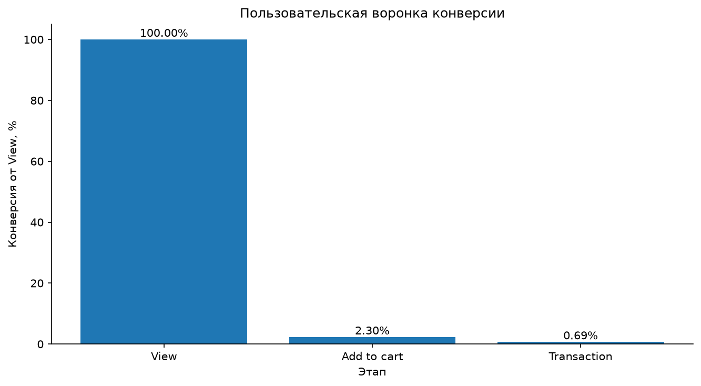
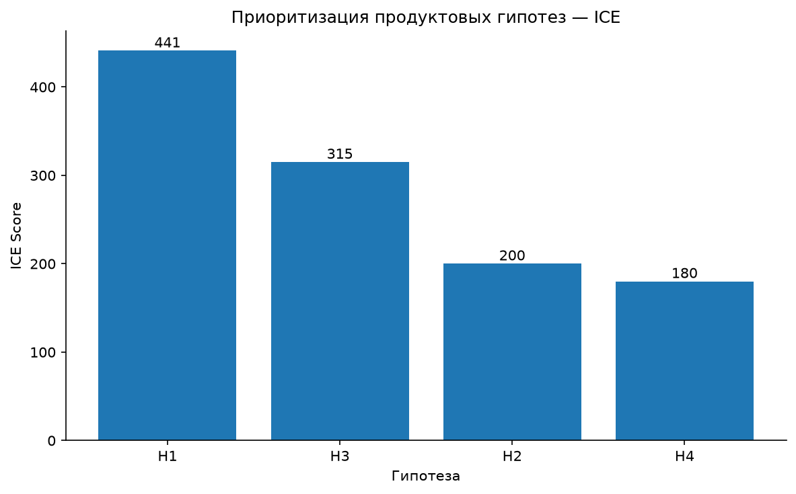

# Отчёт 10 — Продуктовые гипотезы и A/B-тестирование

## 1. Цель

Задача — на основе предыдущего анализа сформулировать продуктовые гипотезы, расставить приоритеты и подготовить базовый план A/B-теста. В работе: последовательная воронка View → Add to cart → Transaction, базовые конверсии, четыре гипотезы, приоритизация по ICE и расчёт размера выборки для теста улучшения конверсии добавления в корзину.

## 2. Данные и ограничения

Источник — `events.csv`. Период 03.05.2015 — 18.09.2015 (UTC). В файле 2 756 101 событие, 1 407 580 пользователей и 235 061 товар. Доступны события `view`, `addtocart` и `transaction`.

Чего в данных нет: цен, выручки, маржи, показов рекламы, информации об ошибках checkout, отменах и возвратах. Поэтому выручку, AOV, прибыльность и влияние изменений на эти показатели по этому датасету рассчитать нельзя.

## 3. Как строилась воронка

Воронка на уровне пользователя (`visitorid`). Для каждого пользователя бралось самое раннее время каждого типа события:

- `view` — первый просмотр;
- `addtocart` — первое добавление в корзину;
- `transaction` — первая транзакция.

Пользователь попадал на следующий этап, только если порядок первых событий соблюдён: `view` не позже `addtocart`, а `addtocart` не позже `transaction`.

Это строгое правило. Оно не гарантирует, что все события относятся к одному товару или одной сессии. Пользователь может выпасть из последовательного этапа, даже если позже действовал по правильной последовательности, но его самое раннее событие нужного типа нарушило порядок.

## 4. Результаты воронки

| Этап | Пользователей | Конверсия от View | Конверсия от предыдущего этапа |
|---|---:|---:|---:|
| View | 1 404 179 | 100,00% | 100,00% |
| Add to cart | 32 272 | 2,30% | 2,30% |
| Transaction | 9 682 | 0,69% | 30,00% |

До добавления в корзину доходят 32 272 пользователя из 1 404 179 с просмотром — конверсия 2,30%. Из тех, кто прошёл этап корзины, 30,00% доходят до транзакции. Итоговая конверсия View → Transaction — 0,69%.

Отдельно стоит различать пользователей с любым событием и пользователей, прошедших последовательную воронку. Например, с любым `addtocart` — 37 722 человека, а в этап View → Add to cart попали 32 272. Для транзакций — 11 719 и 9 682 соответственно. Разница — те, у кого нарушен порядок первых событий.

## 5. Продуктовые гипотезы

| ID | Проблема | Гипотеза / изменение | Основная метрика | Guardrail-метрика | Приоритет |
|---|---|---|---|---|---|
| H1 | Низкая конверсия View → Add to cart | Улучшить карточку товара, сделать информацию понятнее | Add to cart conversion | Purchase conversion | High |
| H2 | Пользователи возвращаются к товарам | Добавить возможность сохранять товары в избранное | Repeat visits | Purchase conversion | Medium |
| H3 | Потери после добавления в корзину | Упростить процесс оформления заказа | Cart to purchase conversion | View to purchase conversion | High |
| H4 | Различия в конверсии товаров | Оптимизировать представление товаров с учётом различий в конверсии | View to purchase conversion | Purchase conversion | Medium |

Гипотезы — это направления для проверки. Наблюдаемые данные сами по себе не доказывают, что предложенные изменения дадут рост конверсии.

По guardrail-метрикам: AOV, выручка, ошибки checkout, отмены и возвраты в датасете отсутствуют. Их нужно добавить в систему аналитики для полноценной оценки экспериментов. Указанные в таблице конверсионные метрики доступны в текущих данных, но бизнес-метрики они не заменяют.

## 6. Приоритизация по ICE

`ICE = Impact × Confidence × Ease`

| Гипотеза | Impact | Confidence | Ease | ICE |
|---|---:|---:|---:|---:|
| H1 | 9 | 7 | 7 | 441 |
| H3 | 9 | 7 | 5 | 315 |
| H2 | 5 | 5 | 8 | 200 |
| H4 | 6 | 5 | 6 | 180 |

Порядок:

1. **H1 — 441**: улучшение карточки товара.
2. **H3 — 315**: упрощение checkout.
3. **H2 — 200**: добавление избранного.
4. **H4 — 180**: оптимизация представления товаров.

Impact, Confidence и Ease — экспертные оценки, а не статистически рассчитанные эффекты. ICE используется для предварительного выбора гипотез, которые стоит проверять первыми.

## 7. Размер выборки для A/B-теста

Рассмотрен эксперимент по увеличению конверсии View → Add to cart.

| Параметр | Значение |
|---|---:|
| Baseline conversion | 2,30% |
| Target conversion | 2,53% |
| Relative MDE | 10% |
| Absolute MDE | 0,23 п.п. |
| Significance level (α) | 0,05 |
| Statistical power (1 − β) | 0,80 |
| Sample size per group | 69 986 |
| Total sample size | 139 972 |

Расчёт для двух независимых долей, равное распределение пользователей между группами, двусторонний уровень значимости 5%, мощность 80%.

Для обнаружения относительного роста конверсии на 10% нужно ориентировочно **69 986 пользователей в каждой группе**, или **139 972 суммарно**.

Это приближённая оценка. Перед запуском нужно:

- определить критерии включения в эксперимент;
- зафиксировать единицу рандомизации (например, пользователь);
- определить окно измерения конверсии после попадания в эксперимент;
- исключить пересечение пользователей между группами;
- заранее зафиксировать primary и guardrail-метрики;
- проверить, что платформа корректно распределяет трафик.

Историческая конверсия за весь период используется как baseline для планирования, но не заменяет измерение на фактической экспериментальной аудитории.

## 8. Итоговые цифры

| Метрика | Значение |
|---|---:|
| Всего пользователей | 1 407 580 |
| Пользователей с View | 1 404 179 |
| Baseline View → Add to cart | 2,30% |
| Baseline Add to cart → Transaction | 30,00% |
| Baseline View → Transaction | 0,69% |
| Количество гипотез | 4 |
| Размер выборки на группу | 69 986 |
| Общий размер выборки | 139 972 |

## 9. Выводы

1. Последовательная конверсия View → Add to cart — 2,30%. Это основная точка воронки, выбранная для планирования эксперимента.
2. Конверсия Add to cart → Transaction среди прошедших последовательные этапы — 30,00%.
3. По ICE наивысший приоритет у H1 (улучшение карточки товара), затем H3 (упрощение checkout).
4. Для проверки роста View → Add to cart на 10% при α = 0,05 и power = 0,80 нужно около 69 986 пользователей на группу.
5. Для полноценной оценки продуктовых изменений необходимо собирать бизнес- и guardrail-метрики: выручку, AOV, ошибки оформления, отмены и возвраты.
