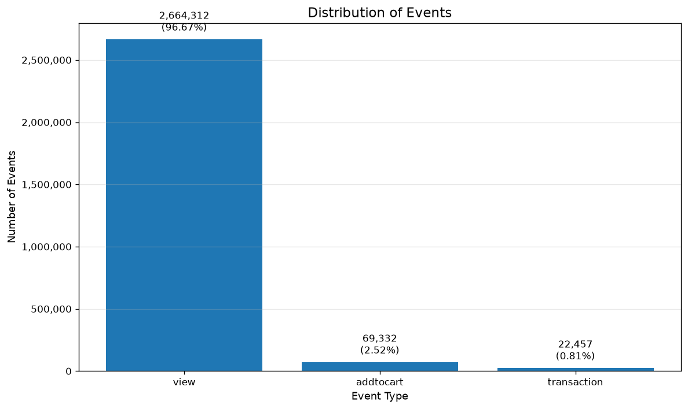
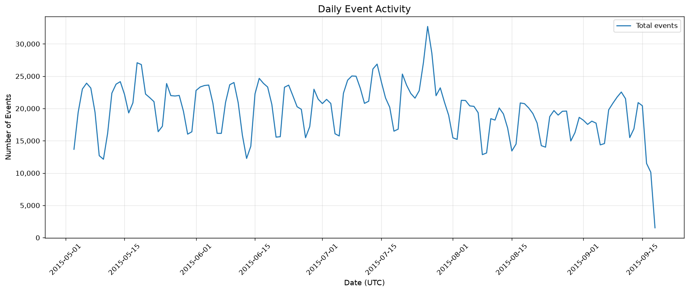
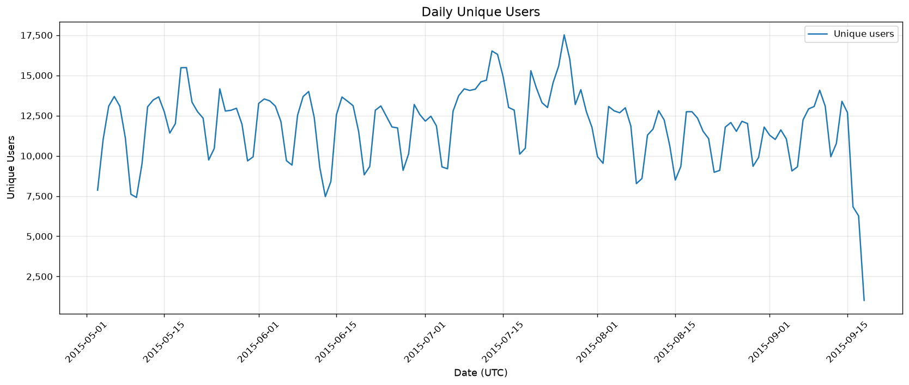
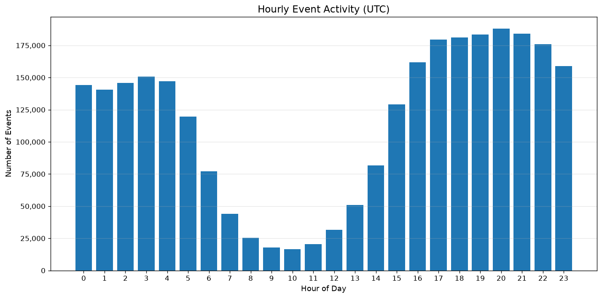
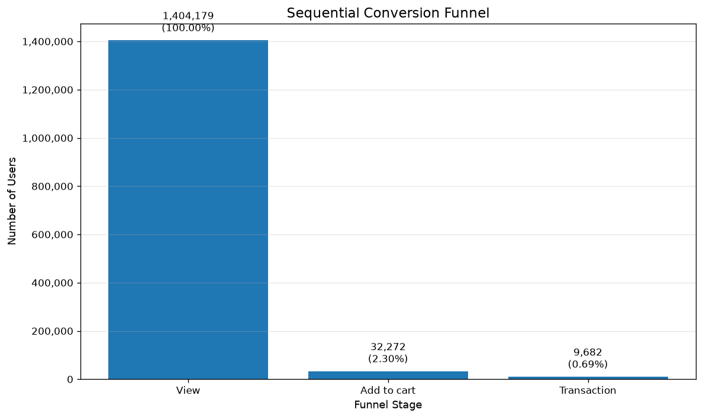
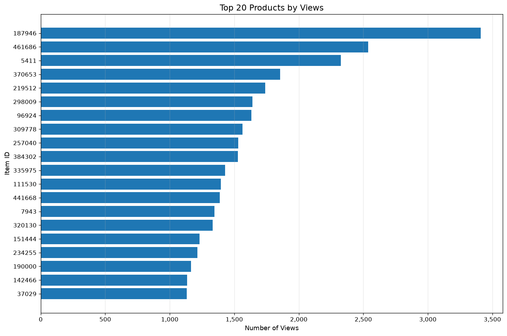
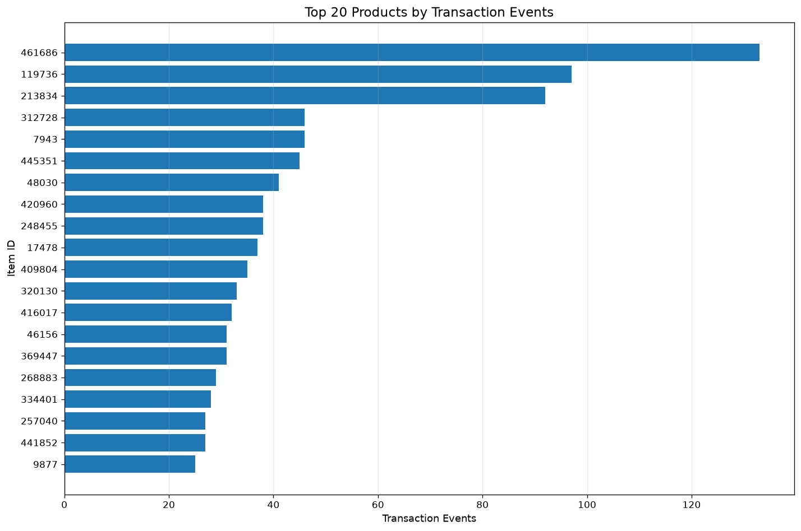
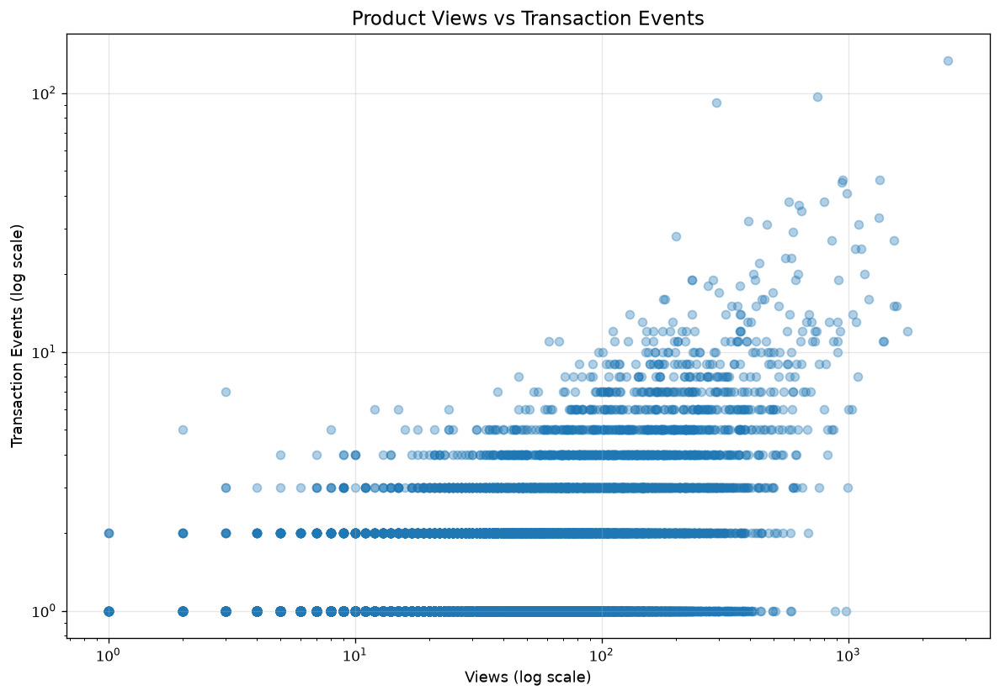
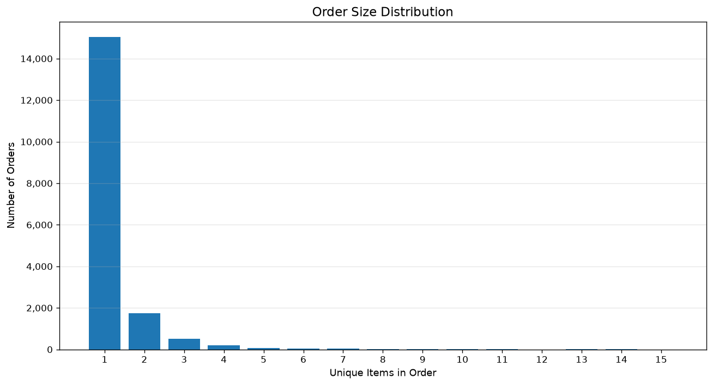
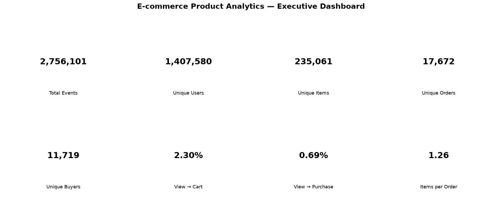

# Отчёт 12 — Визуализация и дашборд

## 1. Цель

Собрать результаты предыдущих ноутбуков в единую систему графиков и подготовить итоговый обзор продуктовых метрик: активность, сегменты, воронка, товары, заказы. Плюс — таблицы с агрегатами для дальнейшего использования.

**Данные:** `events.csv`, 2 756 101 событие, 1 407 580 пользователей, 235 061 товар. Период 03.05.2015 — 18.09.2015.

## 2. Ключевые показатели

| Метрика | Значение |
|---|---:|
| Всего событий | 2 756 101 |
| Уникальных пользователей | 1 407 580 |
| Уникальных товаров | 235 061 |
| Просмотры | 2 664 312 |
| Добавления в корзину | 69 332 |
| События покупки | 22 457 |
| Уникальных заказов | 17 672 |
| Уникальных покупателей | 11 719 |

## 3. Распределение событий

| Событие | Количество | Доля |
|---|---:|---:|
| `view` | 2 664 312 | 96,67% |
| `addtocart` | 69 332 | 2,52% |
| `transaction` | 22 457 | 0,81% |

Просмотры — 96,67% всех событий. Корзина и покупки — единицы процентов. То есть основная масса активности сосредоточена на каталоге, а до более глубоких этапов доходит существенно меньше событий. Та же картина, что в 01, 02 и 11.

## 4. Сегментация пользователей

| Сегмент | Пользователей | Доля |
|---|---:|---:|
| Viewer | 1 368 715 | 97,24% |
| Cart user | 27 146 | 1,93% |
| Buyer | 11 719 | 0,83% |

Большинство (97,24%) ограничивается просмотрами. Доля покупателей — менее 1%. Сегментация совпадает с 06 и 11, правила те же.

## 5. Динамика активности

### 5.1. По дням

Ежедневная активность позволяет отследить изменение числа событий во времени и выявить периоды подъёмов и провалов. Детально это разобрано в 02 и 05 — здесь только визуализация.

### 5.2. По часам

Пик — 20:00 UTC: 187 919 событий, 113 677 уникальных пользователей. Минимум из представленных — 09:00 UTC: 17 909 событий, 12 318 пользователей.

Разница между пиком и минимумом — больше чем в 10 раз. Для планирования маркетинговых кампаний и экспериментов это ориентир, но с оговоркой: всё в UTC, и локальное время пользователей неизвестно.

## 6. Воронка

| Этап | Пользователей | Конверсия от View |
|---|---:|---:|
| View | 1 404 179 | 100% |
| Add to cart | 32 272 | 2,30% |
| Transaction | 9 682 | 0,69% |

Дополнительно: View → Add to cart — 2,30%, Add to cart → Transaction — 30,00%.

Основное сокращение — между просмотром и добавлением в корзину. Дальше воронка держит гораздо лучше: из тех, кто дошёл до корзины, покупают 30%. Это то же, что видно в 03, 09 и 10.

Оговорка: воронка построена по первым событиям пользователя и не гарантирует, что этапы относятся к одному товару или одной сессии. Подробно — в 03 и 10.

## 7. Популярность товаров

Подготовлены рейтинги по просмотрам и по событиям покупки. Это даёт основу для сравнения интереса к товару с фактической покупаемостью.

Важно различать количество событий покупки и количество уникальных заказов: один заказ может содержать несколько товаров. И высокие просмотры не гарантируют покупку — это видно и в 02 (`187946` — 2 911 просмотревших, 0 покупок), и в 09 (ρ = 0,0656 между просмотрами и конверсией).

## 8. Связь просмотров и покупок

Диаграмма рассеяния показывает, насколько часто просматриваемые товары также покупаются. Позволяет выделить товары с большим числом просмотров и малым числом покупок — то есть те, где карточка или предложение может быть проблемой.

Оговорка: количество событий не является конверсией товара. Для корректного расчёта нужна согласованная методика связывания просмотров и покупок по пользователям и периодам — в этом ноутбуке такой связи не делается.

## 9. Размер заказов

| Метрика | Значение |
|---|---:|
| Заказов | 17 672 |
| Среднее товаров в заказе | 1,26 |
| Максимум товаров в заказе | 31 |
| Заказов с несколькими товарами | 2 643 |

Большинство заказов однотоварные — 85%. Это ограничивает market basket (07): пары можно искать только в оставшихся 15% заказов. Среднее 1,26 — не средний чек: цен в данных нет.

## 10. Итоговый дашборд

Собран общий dashboard с ключевыми метриками проекта: события, пользователи, товары, просмотры, корзина, покупки, заказы, покупатели, конверсии между этапами воронки и среднее число товаров в заказе. Это сводка, по которой можно быстро оценить состояние магазина и точки, где теряется аудитория.

## 11. Основные выводы

1. 96,67% всех событий — просмотры. До корзины доходят 2,30% пользователей, до покупки — 0,69%.
2. 97,24% пользователей — Viewer. Покупателей — 0,83%.
3. Конверсия Add to cart → Transaction — 30,00%. То есть после корзины воронка работает гораздо лучше, чем на первом переходе.
4. Пик активности — 20:00 UTC. Все времена в UTC, локальное время пользователей неизвестно.
5. 85% заказов однотоварные, среднее число товаров в заказе — 1,26. Это ограничивает рекомендации на основе совместных покупок.

Из этого следуют направления для дальнейшей работы: улучшение карточки товара и перехода в корзину, разбор причин отказа после добавления в корзину, развитие рекомендаций сопутствующих товаров. Эти направления — гипотезы, а не доказанные проблемы; причины по этим данным не установить.

## 12. Ограничения

- **Нет цен, выручки, себестоимости, маржинальности.** Средний чек, доход, прибыль — не считаются.
- **Нет данных о рекламных расходах и каналах.** Нельзя оценить стоимость привлечения или разложить трафик по источникам.
- **Период ограничен** 3 мая — 18 сентября 2015. Конец периода обрывается посреди недели, что влияет на дневную и недельную динамику.
- **Событие покупки ≠ уникальный заказ.** Один заказ может содержать несколько товаров.
- **Воронка не привязана к товару или сессии.** Она отражает последовательность первых событий пользователя в целом.
- **Наблюдения — ассоциации, а не причинность.** По этим данным нельзя утверждать, что изменение одного показателя приведёт к изменению другого.

Итог: результаты позволяют анализировать поведение пользователей и продуктовые метрики, но финансовую эффективность по этому датасету оценить нельзя.

## 13. Результаты

Экспортировано 11 PNG-графиков и 12 CSV-таблиц:

- `reports/figures/` — графики;
- `reports/tables/` — агрегаты.

## 14. Заключение

Ноутбук 12 закрывает практическую часть проекта: результаты предыдущих этапов собраны в единый набор визуализаций и итоговый дашборд.

Что в этом ноутбуке самое полезное помимо самих графиков:

- Он показывает, что метрики из разных отчётов согласованы. Сегменты (06), заказы (07), воронка (10) и SQL-агрегации (11) в сводке сходятся — расхождений нет.
- Воронка 32 272 / 9 682 совпадает с 10 и 11, но не с 03 (32 934 / 9 952). Это разные правила фильтрации, и в сводке используется строгий вариант.
- Визуализация делает очевидным главный перекос: 96,67% событий — просмотры, 97,24% пользователей — Viewer. Это не «проблема checkout», а проблема перехода от интереса к первому действию.
